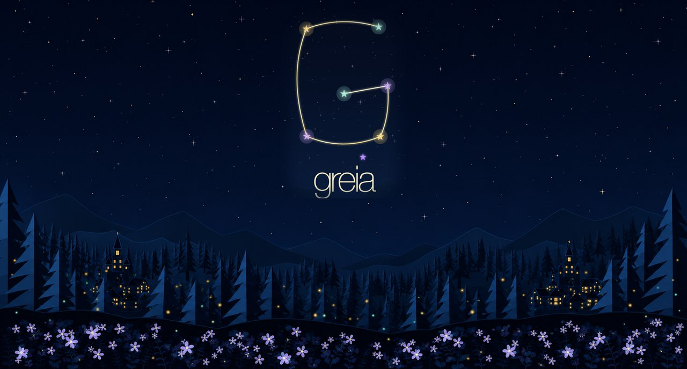
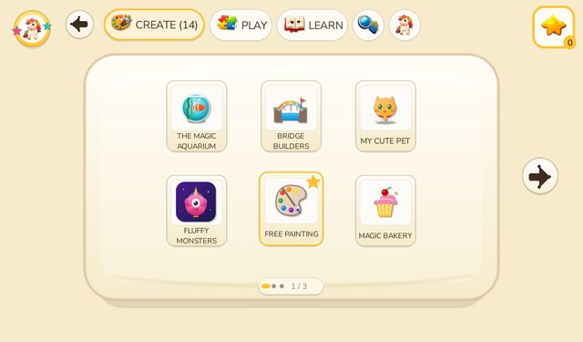
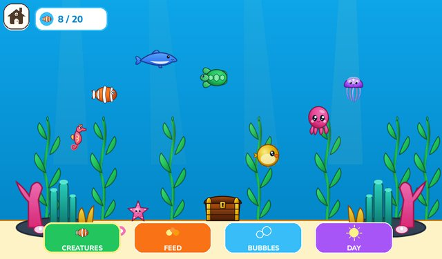
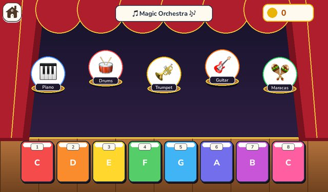
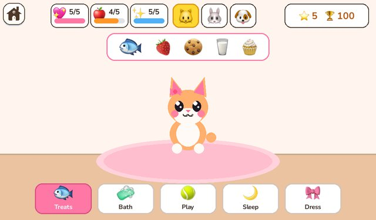
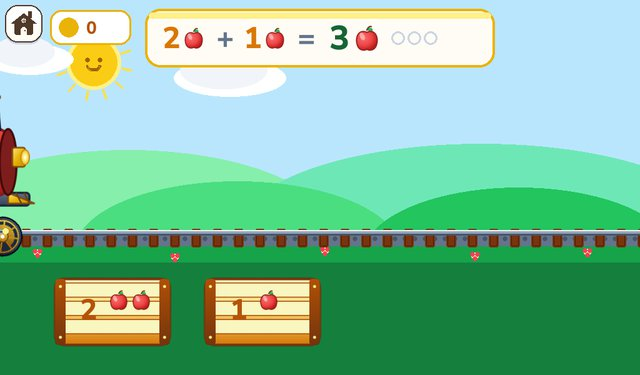
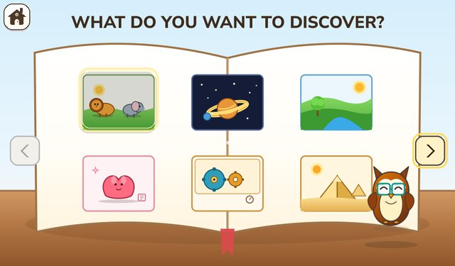
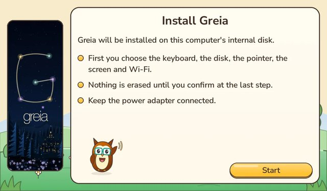
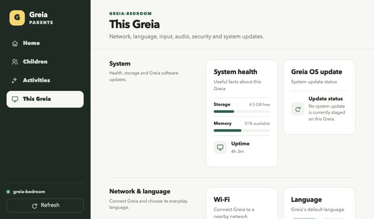

<p align="center">
  
</p>

<h1 align="center">Greia OS</h1>

<p align="center">
  <b>Greia turns an old laptop into a small learning computer for young children.</b>
</p>

<p align="center">
  🌐 <a href="https://www.frozenpepper.it/greia/"><b>Website</b></a> &nbsp;·&nbsp;
  ⬇️ <a href="https://www.frozenpepper.it/greia/downloads.html"><b>Download the installer</b></a> &nbsp;·&nbsp;
  💬 <a href="https://discord.gg/TWuT3z7BVu"><b>Join us on Discord</b></a>
</p>

A child switches it on, picks their own picture, and chooses something to
play, draw, write or learn. There is no desktop, no terminal and no web
browser to get lost in. Greia works without the internet, keeps each child's
work on the computer, and lets a grown-up manage everything from a phone.

Greia is free and open source. It runs on a Linux base, but children never
see it. It is built for very modest machines first: the reference computer is
the first-generation Acer Aspire One netbook. Raspberry Pi 400 and 500 are
planned targets, but there is no Raspberry Pi image yet.

## What children see

Big pictures, friendly voices, and one Home button that always brings them back.

<table>
  <tr>
    <td width="33%"><br><sub><b>Home:</b> pick something to create, play or learn</sub></td>
    <td width="33%"><br><sub><b>The Magic Aquarium:</b> care for sea creatures</sub></td>
    <td width="33%"><br><sub><b>Magic Orchestra:</b> play notes and instruments</sub></td>
  </tr>
  <tr>
    <td width="33%"><br><sub><b>My Cute Pet:</b> feed, wash and play</sub></td>
    <td width="33%"><br><sub><b>Number Express:</b> first sums with apples</sub></td>
    <td width="33%"><br><sub><b>Greia Encyclopedia:</b> explore animals, space and the world</sub></td>
  </tr>
</table>

<p align="center">
  <br>
  <sub>Six friends guide the way, in English, Italian, Spanish and French.</sub>
</p>

> **Status: technical preview (`0.13.1-preview.1`), not a family release.**
> A preview installer for Acer Aspire One class PCs is on the
> [downloads page](https://www.frozenpepper.it/greia/downloads.html). It has
> passed testing in virtual machines. It has **not** yet been tested on enough
> real computers, and some recordings still need replacing before a full
> release. Try it on a spare computer, not one you rely on.
> Distribution and media-rights caveats: [licensing notice](NOTICE.md).

## Get Greia

Installing Greia **erases the whole disk** of the computer you put it on.
Use a spare computer, and copy off anything you want to keep.

1. **Download** the Greia installer from the
   [downloads page](https://www.frozenpepper.it/greia/downloads.html). It is
   one big file ending in `.img`.
2. **Put it on a USB stick.** Use a stick of 4 GB or more with nothing
   important on it. A free program called balenaEtcher does this for you on
   Windows, Mac and Linux. The stick will be erased.
3. **Start the computer from the stick.** Plug it in, switch on, and tap the
   boot-menu key (often F12) until a list appears. Choose the USB stick.
4. **Follow the pictures.** Pick a language, a keyboard and the disk. Nothing
   is erased until the last screen, and only after you hold the button down
   for two seconds.
5. **Take the stick out** when the installer says it is finished, then start
   the computer again. Greia opens with a screen where your child picks a
   profile.

Step-by-step with screenshots and fixes for common problems:
[Install Greia from a USB stick](docs/user/INSTALL_FROM_USB.md).
Greia installs on PCs, not on Macs, and the Raspberry Pi is not supported yet.
Your Windows PC or Mac is only used to prepare the stick.

## For parents

<table>
  <tr>
    <td width="50%"><br><sub>The installer explains every step in plain words.</sub></td>
    <td width="50%"><br><sub>The Parents app, on your phone or laptop.</sub></td>
  </tr>
</table>


- **Open the parent settings** on the computer itself: on the profile screen,
  hold the **S** and **T** keys together for five seconds.
  [Greia Parents guide](docs/user/GREIA_PARENTS.md)
- **Manage Greia from your phone** or laptop on the same home Wi-Fi. No
  account and no cloud. [Greia Parents guide](docs/user/GREIA_PARENTS.md)
- **Choose what each child sees**, with separate profiles, language and
  play-time limits. [What parents can manage](docs/product/PARENT_MANAGEMENT.md)
- **Keep Greia up to date** without losing your child's work. If an update
  goes wrong, Greia goes back to the last working version.
  [How updates work](docs/product/SYSTEM_UPDATES.md)
- **Backups** of a child's work are planned but not finished yet.
- **Privacy:** no ads, no tracking, no account. Everything stays on the
  computer. [PRIVACY.md](PRIVACY.md)

Greia comes with 45 Activities for roughly ages 3 to 7: painting, writing,
numbers, letters, music, stories and more. You can choose English, Italian,
Spanish or French.

## Help build Greia

You do not have to be a programmer. Artists, translators and voice
reviewers are welcome too. Start with [CONTRIBUTING.md](CONTRIBUTING.md), and
come say hello on [Discord](https://discord.gg/TWuT3z7BVu): questions, ideas and "it works on my
old laptop!" stories are all welcome.

| I want to... | Read this |
|---|---|
| Make a new Activity (game, tool, story) | [Create an Activity](docs/development/CREATE_AN_ACTIVITY.md) |
| Add or translate a language | [Add a Greia language](docs/development/ADD_A_GREIA_LANGUAGE.md) |
| Record or review voices | [Voice production skill](skills/greia-voice-production/SKILL.md) and [voice tool](tools/greia_voice_core/README.md) |
| Draw art and icons | [Art and graphics system](docs/design/GREIA_ART_GRAPHICS_SYSTEM.md), [SVG rules](docs/design/GREIA_SVG_AUTHORING_RULES.md) |
| Build an installer image | [Build a Greia image](docs/development/BUILD_A_GREIA_IMAGE.md) |
| Test an Activity on my desktop | [Activity Simulator](docs/development/GREIA_ACTIVITY_SIMULATOR.md) |
| Work on the Shell, Parent API or installer | [OS work skill](skills/greia-os-work/SKILL.md), [engineering foundations](docs/engineering/ENGINEERING_FOUNDATIONS.md) |
| Report a bug | [Open an issue](https://github.com/frozenpepper/Greia/issues) with your computer model and what you saw |
| Report a security problem | Privately, as described in [SECURITY.md](SECURITY.md) |
| Find my way around the docs | [Documentation map](docs/README.md) |

To try the Simulator, you need Python 3.11+, `git` and `make`:

```bash
git clone https://github.com/frozenpepper/Greia.git
cd Greia
python3 -m pip install -r requirements-dev.txt
python3 tools/greia_simulator.py     # run the real Shell on your desktop
make verify                          # run all tests and checks
```

The Simulator and desktop tests do not prove anything about real hardware.
Say where you tested when you open a pull request.

## For AI agents

1. Start at [AGENTS.md](AGENTS.md): the rules and product contracts.
2. Then [SETUP.md](SETUP.md): what to install for your role.
3. Then the matching skill in [skills/](skills/README.md). The
   [agent index](docs/agents/README.md) lists which manual fits which task.

## License, trademark, privacy, security

- **Code** is under the [Mozilla Public License 2.0](LICENSE). Documentation
  is intended for CC BY 4.0. Fonts and media from others keep their own
  licenses, and the audit is still under way: see [NOTICE.md](NOTICE.md).
- **The Greia name and logo** are covered by the [trademark guide](TRADEMARK.md).
  You may truthfully say a product "runs Greia OS".
- **Privacy:** [PRIVACY.md](PRIVACY.md). **Security:** [SECURITY.md](SECURITY.md).
  **Conduct:** [CODE_OF_CONDUCT.md](CODE_OF_CONDUCT.md).
- **Website:** https://www.frozenpepper.it/greia/ · **Discord:** https://discord.gg/TWuT3z7BVu · **Contact:** greia@frozenpepper.it. **History:** [CHANGELOG.md](CHANGELOG.md).
