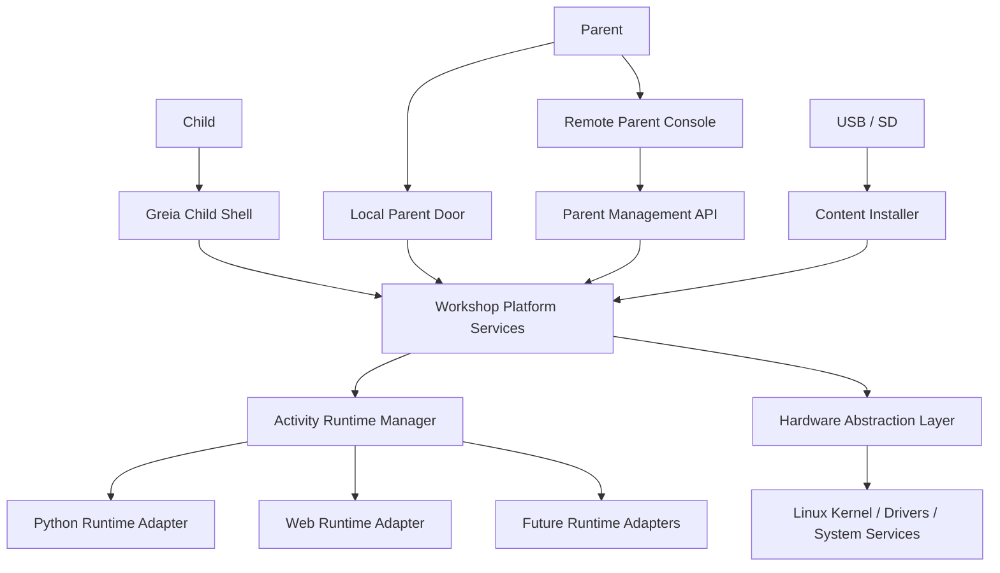
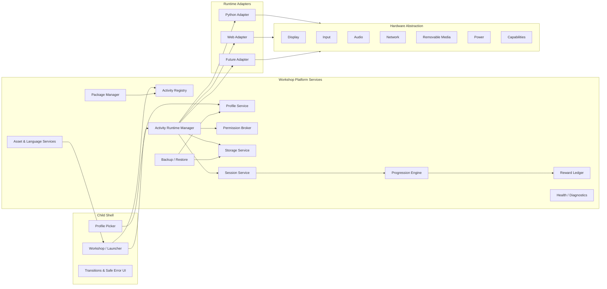
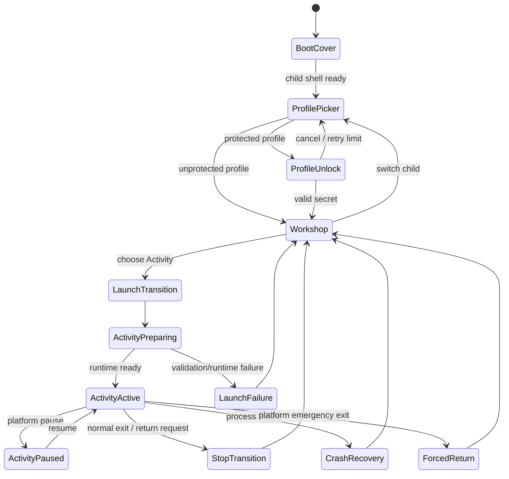
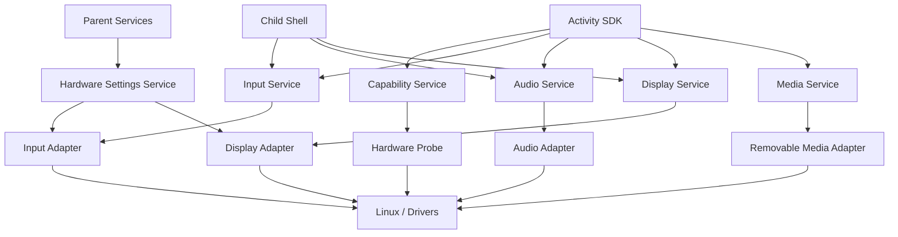
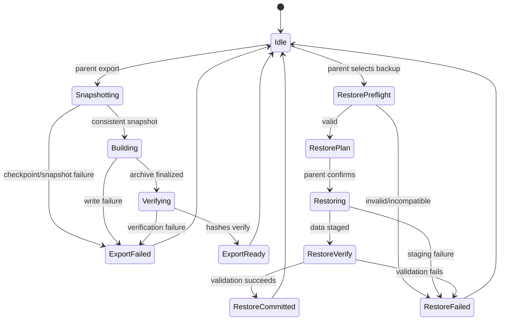

# ADR 0012 — Greia Platform Architecture Constitution

**Status:** Accepted architecture constitution; Phase 0 implementation remains evidence-gated  
**Date:** 2026-08-07  
**Decision scope:** Product architecture, runtime model, activity contract, platform services, storage, packaging, backup, security, hardware abstraction, portability, and extension policy  
**Implementation baseline when accepted:** `0.10.0-phase0-dev` / ADRs 0001–0011  
**Normative audience:** maintainers, contributors, activity authors, build engineers, reviewers, local agents, and future architecture agents

---

## 0. Why this document exists

Greia is not a themed Linux desktop and it is not a collection of unrelated games. It is a console-like educational operating environment in which Linux is an implementation substrate and **Activities** are the stable product abstraction.

Earlier project documents correctly established many parts of this design: the no-shell experience, a launcher-first appliance, one shared Python runtime for the first vertical slice, a strict resource floor, explicit child profiles, platform-owned rewards, bounded parent controls, fail-closed installation, and activity isolation. The architecture brainstorming session of 2026-08-07 clarified the next layer above those implementation choices: the platform must not be permanently shaped around Python, X11, a particular CPU architecture, or a particular display stack. Those are replaceable adapters beneath stable platform contracts.

This ADR therefore acts as the project's **architecture constitution**. It does four things that the earlier documents intentionally did not attempt in one place:

1. defines the stable concepts and boundaries that future implementations must preserve;
2. separates **product architecture** from **Phase 0 implementation choices**;
3. specifies portable contracts for activities, saves, packages, backups, sessions, progression, permissions, and runtime adapters;
4. records the rationale and rejected alternatives for major decisions so later contributors do not accidentally re-open settled questions without evidence.

This is an umbrella ADR. It does not erase the technical evidence and narrower decisions in ADRs 0001–0011. Where a narrower ADR describes the implementation of a product-level rule, both apply. Where an older design document says that Python or Xorg is the only possible long-term implementation, this ADR clarifies that statement as a Phase 0 constraint rather than a permanent public contract.

### 0.1 Normative language

The words **MUST**, **MUST NOT**, **SHOULD**, **SHOULD NOT**, and **MAY** describe architectural strength:

- **MUST / MUST NOT** — a non-negotiable platform invariant. Changing it requires a superseding ADR that explicitly names this constitution and explains the product-level consequence.
- **SHOULD / SHOULD NOT** — the default architecture. Deviations require evidence and should normally be recorded in an ADR.
- **MAY** — an allowed implementation or extension choice that does not alter the public platform contract.

### 0.2 Decision hierarchy

When project documents appear to conflict, use this order:

1. safety-critical acceptance evidence and explicit newer ADRs;
2. this architecture constitution for platform-level concepts;
3. narrower ADRs 0001–0011 for the implementation decisions they own;
4. the authoritative active phase plan;
5. subsystem design documents;
6. historical review notes and brainstorming handovers.

A newer document does not magically make untested hardware behavior true. For example, this ADR establishes that the display stack is replaceable, but it does **not** prove that direct DRM/KMS works on the Acer. Phase 0 continues to use the evidence-gated display implementation selected by the active phase plan until a measured replacement is accepted.

### 0.3 Architectural state labels

Every significant feature should be described with one of these labels:

- **CONSTITUTIONAL** — stable product contract defined here.
- **SELECTED** — concrete implementation chosen by an ADR.
- **PROVISIONAL** — usable for development/evidence but not acceptable as the final release implementation.
- **DEFERRED** — intentionally outside the active phase, but architecture must leave room for it.
- **UNPROVEN** — implemented or planned but missing required runtime/hardware evidence.

This vocabulary prevents source implementation from being confused with accepted real-world behavior.

---

# Part I — Product philosophy

## 1. Product statement: a console-like OS for children

Greia turns supported computers into self-contained educational appliances for children. The child should experience one coherent world: power on, choose a profile, enter the Professor Pip workshop, pick an activity, play or create, return safely, and find progress preserved.

The child is not expected to understand:

- Linux;
- filesystems;
- package managers;
- application runtimes;
- windows or desktops;
- network configuration;
- software installation;
- CPU architecture;
- process crashes;
- dependency management.

Those concerns belong to the platform and the parent management layer.

The closest mental model is a **game console or educational appliance**, not a PC desktop. A console can contain very different games while presenting one identity, one controller model, one profile system, one save system, one update model, and one store/library. Greia follows the same principle but applies it to educational and creative activities.

## 2. The child's graphical environment is the OS

Linux remains underneath, but it is not part of the child's product surface. From the child's point of view, the Greia graphical shell **is the operating system**.

The shell owns:

- boot arrival and branded continuity;
- child profile selection;
- the workshop/world and navigation model;
- activity discovery and presentation;
- activity transitions;
- global overlays and emergency return;
- progression, rewards, achievements, and discoveries;
- profile-specific customization;
- child-safe failure states;
- return to the workshop after normal exit or failure.

A conventional desktop, taskbar, dock, terminal, file manager, browser chrome, display manager, package manager, or Linux login flow would expose the substrate and therefore violate the product model.

## 3. Activities, not applications or runtimes

The central abstraction is **Activity**.

An Activity can be a maze, a drawing studio, an interactive story, a science simulation, a music toy, a reading exercise, a settings experience, or a future hardware project. The operating system does not categorize an Activity by its implementation language.

The conceptual relationship is:

```text
                    Greia
                         │
                    Activity
                         │
                 Runtime Adapter
                ┌────────┼─────────┐
                │        │         │
              Python     Web     Future
```

The runtime is an implementation property of the package. Profiles, installation, saves, progress, rewards, permissions, sessions, lifecycle, backup, parent controls, and activity discovery remain platform services above that property.

### Rationale

If the platform thinks in terms of "Python games" and "web games," every cross-cutting feature is duplicated. Two installation systems lead to two update systems; two save models lead to broken backups; two progression APIs create inconsistent rewards. Activity-first architecture prevents that fragmentation.

### Rejected alternative: runtime-first product categories

Rejected because it leaks implementation details into user experience and multiplies platform logic. A parent should never need to decide whether a package is a Python app or an HTML app before installing it.

## 4. Platform-owned cross-cutting concerns

Activities own their educational experience and private state. The platform owns the concerns that must be consistent and trustworthy across the machine.

**Platform-owned:**

- child identity and profile selection;
- activity registry and compatibility;
- launch/suspend/stop/crash supervision;
- automatic session history;
- capability and permission enforcement;
- global progression and rewards;
- save namespace allocation;
- backup/export/restore;
- package installation, update, rollback, and removal;
- parent authorization;
- device and hardware abstraction;
- language and shared accessibility services;
- global visual/audio policy;
- recovery and diagnostics.

**Activity-owned:**

- local game or activity rules;
- activity-specific content;
- level/puzzle state;
- drawings and creations;
- activity-local preferences;
- activity-defined save schema and migrations;
- educational events it reports to the platform.

Activities **report facts and intent**. They do not directly mutate platform authority.

## 5. Offline-first and ownership-first

A child must be able to boot, choose a profile, open installed activities, create things, save progress, earn local rewards, and return to the workshop without an internet connection.

Parents must be able to export the child's portable data to a file they control. Cloud synchronization can be added later, but it cannot be the only owner of saves or identity.

The open `.greiaactivity` and `.greiabackup` formats defined later in this document are a direct consequence of this philosophy.

## 6. Low-end hardware is a design constraint, not a compatibility mode

The first-generation Acer Aspire One remains the hard reference floor for Phase 0. The architecture must also treat ARM systems such as Raspberry Pi-class devices and modern x86-64 systems as first-class targets.

This does **not** mean every image contains every runtime and feature. It means all supported images implement the same platform contracts, and Activities declare capabilities rather than hard-coding device models or CPU names.

A feature that only works on modern hardware may be capability-gated. A change that unnecessarily raises the core resource floor is an architectural regression.

## 7. Parent authority is distinct from child authority

The parent management layer is not merely another Activity with filesystem privileges. It is a separate trust domain controlling machine configuration, content lifecycle, backups, recovery, networking, and diagnostics.

The child can make bounded choices the platform intentionally delegates—for example selecting an avatar or workshop colors—but cannot acquire administrative authority by navigating the child shell.

## 8. Children should not pay for implementation complexity

The system can contain complicated internals, multiple runtime adapters, hardware profiles, migrations, rollback slots, and compatibility layers. None of that should become a child workflow.

The child-facing rule is simple:

> pick a profile → pick an activity → use it → return.

The parent-facing rule should be nearly as simple:

> install/update/backup/configure through bounded graphical operations.

---

# Part II — Non-negotiable architectural principles

## 9. Constitutional principles

The following principles are permanent unless explicitly superseded.

### P-01 — The Linux substrate is hidden from normal child use

No desktop environment, desktop shell, login prompt, terminal, console, package manager, filesystem browser, browser chrome, or ordinary boot text may appear during supported normal child operation.

### P-02 — Greia owns the graphical child session

There is one coherent child-facing shell. Third-party desktop shells and window managers are not part of the product architecture.

### P-03 — Activity is the universal content abstraction

All educational/creative content packages use one logical package, metadata, lifecycle, storage, session, permission, progress, install, and backup model independent of runtime.

### P-04 — Runtime adapters are replaceable platform components

Python, Web, and future runtimes plug into the Activity Runtime Manager. Runtime-specific behavior must remain below the Activity contract.

### P-05 — One curated runtime environment per runtime family

For a given platform runtime family, the OS ships a curated shared environment. Activities may not create independent dependency graphs on the child machine.

For Python this means one approved Python runtime/library catalogue. For a future Web adapter it means one platform-owned browser engine/runtime policy rather than bundled browsers or executable browser installers per Activity.

### P-06 — Activities are capability-oriented, not architecture-oriented

An Activity asks for capabilities such as pointer input, audio, Canvas2D, camera, or GPU acceleration. Hardware profiles advertise capabilities. CPU architecture is normally an implementation/build detail.

### P-07 — Platform services own global progression

Activities emit educational and gameplay events. They cannot directly grant global currency, achievements, unlocks, or modify another Activity's progress.

### P-08 — Platform services own save placement

Activities never choose arbitrary persistent locations. The platform allocates a profile-scoped, activity-scoped namespace.

### P-09 — Sessions are automatic

Every Activity launch produces a platform session record even if the Activity crashes before it writes anything.

### P-10 — Profiles are application identities, not desktop logins

Children choose a Greia profile on every boot. Profile data is isolated independently of the underlying Linux login model.

### P-11 — Parent management is typed and bounded

Routine parent operations are structured capabilities, not a remote shell API. Advanced shell access, if enabled, is a separately authenticated recovery/administration feature.

### P-12 — Installation and updates are transactional

A new or updated Activity is validated before activation. Existing working content is not overwritten in place.

### P-13 — Backups are architecture-neutral

Portable child data must not depend on CPU byte order, Python object layout, host absolute paths, or transient machine identifiers.

### P-14 — Activity and backup formats are openly documented

Parents and future maintainers must be able to understand the package and backup structures without proprietary tooling.

### P-15 — Removable media is content input, never autorun

Inserting USB/SD may trigger a safe scan and graphical prompt. It must never execute code directly from removable media.

### P-16 — Fail closed at trust boundaries

If a required sandbox, verifier, identity check, permission broker, or destructive-operation safety gate fails, the platform must not silently fall back to a less safe path.

### P-17 — Resource cost is part of architecture

Disk, RAM, startup latency, steady-state CPU, and dependency cost are acceptance dimensions. A feature can be logically elegant and still be architecturally unacceptable on the reference floor.

### P-18 — Display implementation is not a public Activity contract

X11, direct DRM/KMS, a compositor, SDL backend choice, and framebuffer details remain replaceable below platform display/input services. No Activity may require direct knowledge of them.

### P-19 — Child UI remains symbol-first

Reading can be educational content, but reading is not a prerequisite for navigating the core OS.

### P-20 — Architecture changes require reason, not fashion

Replacing a component because another stack is newer is insufficient. Changes must improve an explicit requirement and preserve the platform contracts.

---

# Part III — System context and component architecture

## 10. System context diagram



## 11. Layer model

The architecture has five logical layers.

### Layer 1 — Linux substrate

Responsibilities:

- kernel and drivers;
- init/service supervision;
- filesystems and block devices;
- networking primitives;
- device enumeration;
- graphics/audio/input kernel interfaces;
- cryptographic primitives and system security features;
- bootloader and initramfs;
- low-level package/build base.

This layer is not exposed as a child API.

### Layer 2 — Platform hardware and privileged services

Responsibilities:

- hardware capability discovery;
- display/input/audio adapters;
- removable-media mounting;
- power state;
- networking configuration;
- update/install/recovery operations;
- narrow privileged helpers;
- activity sandbox setup;
- machine health.

This layer translates distribution/device details into typed platform operations.

### Layer 3 — Workshop platform services

Responsibilities:

- profiles;
- Activity registry;
- runtime selection;
- storage namespaces;
- session journal;
- progression/rewards;
- shared assets;
- language/literacy resources;
- permissions;
- package lifecycle;
- backup/restore;
- parent management API;
- diagnostics and health.

This is the durable logical core of Greia.

### Layer 4 — Child shell and system Activities

Responsibilities:

- profile picker;
- workshop navigation;
- Activity tiles and transitions;
- platform-owned settings Activities;
- child-safe error/recovery overlays;
- global escape/return behavior;
- visible progression and customization.

### Layer 5 — Activities

Responsibilities:

- educational/creative experience;
- activity-local state;
- activity-local assets/content;
- reporting events through SDK contracts.

Activities must not depend directly on Layers 1–2.

## 12. Logical component diagram



## 13. Service boundary rule

The architecture should be modular without turning a 768 MiB appliance into a microservice farm. "Service" is a **logical boundary**, not necessarily a separate process.

A service may be implemented as:

- a Python class behind a typed protocol;
- a local IPC endpoint;
- a small system daemon;
- a privileged helper;
- a runtime bridge.

The selection is based on privilege, fault isolation, performance, and memory—not on a requirement that every interface become a daemon.

### Rejected alternative: one giant supervisor process

Rejected because it couples unrelated responsibilities and makes testing/replacement difficult.

### Rejected alternative: one process per conceptual service

Rejected because process count, memory, startup time, and IPC complexity would violate the low-end design without providing equivalent benefit.

## 14. Authority matrix

| Concern | Child Shell | Activity | Runtime Adapter | Platform Service | Parent | Privileged Layer |
|---|---|---|---|---|---|---|
| Select active profile | yes | no | no | validates | manage | enforce storage boundary |
| Read own save | via service | yes | brokers | owns namespace | backup/manage | filesystem enforcement |
| Read sibling save | no | no | no | no | backup/admin only | deny |
| Emit score/event | display | yes | transports | validates/applies | view policy | no |
| Grant global reward | display | no | no | yes | configure later | no |
| Change system resolution | no | no | no | typed request only | yes | apply bounded mode |
| Install Activity | no | no | no | validate/stage | yes | copy/activate |
| Network access | no default | capability only | enforces | policy | grant/revoke | sandbox/firewall |
| Raw removable media | no | capability-gated view | brokers | scans/imports | manage | read-only mount |
| Shell command | no | no | no | no generic API | advanced mode only | explicit helper |


---

# Part IV — Boot, session, and activity lifecycle

## 15. Boot architecture: power-on to profile selection

The supported normal boot path is a controlled visual state machine. The exact graphics backend may change, but the child-visible contract does not.

```text
Power on
  │
  ├─> firmware / platform initialization
  │
  ├─> bootloader under branded policy
  │
  ├─> kernel + initramfs
  │
  ├─> noninteractive graphical boot cover
  │
  ├─> essential platform service readiness
  │      ├─ profile registry readable/recoverable
  │      ├─ graphics/input available
  │      ├─ Activity registry index readable/recoverable
  │      └─ child shell supervisor available
  │
  ├─> child shell renders complete first frame
  │
  ├─> graphical handoff releases boot cover
  │
  └─> profile picker is the first interactive child state
```

### 15.1 Profile picker is mandatory

Every child boot MUST reach the graphical profile picker, including a machine with only one child profile. The platform MUST NOT silently resume the previous child.

Reasons:

- physical devices are shared between siblings;
- silent resume creates save/progression leakage;
- a consistent boot ritual is easier for young children;
- per-profile customization is visible immediately;
- password protection cannot work reliably if selection is bypassed.

**Amendment 2026-10-17 — first-profile setup.** On a brand-new device the
registry holds only the placeholder that `ProfileStore.ensure_initialized`
creates (marked `first_profile_setup` in `profiles.json`). While that holds,
the child Shell shows the voiced first-profile setup Screen instead of a picker
with an anonymous placeholder card; finishing it writes the profile through
`ProfileStore.complete_first_profile` and enters Home with it. This is explicit
creation by the person at the device, not a silent resume: every later boot
reaches the profile picker as above, and any Parent create/rename/delete ends
setup. Adding further children remains Parent-gated. Product behaviour:
`docs/product/FIRST_BOOT_PROFILE_SETUP.md`.

### 15.2 Boot cover is a contract, not a brand animation detail

The boot cover MUST be noninteractive from the child's perspective. Ordinary keys must not reveal diagnostic details. The platform must have a graphical failure strategy for the portion of boot it controls.

The current stock Plymouth backend is **PROVISIONAL** because ADR 0011 established that Escape can expose details and KMS absence can produce text fallback. This constitution does not weaken that release blocker.

### 15.3 X11 is not a constitutional dependency

The current Phase 0 source uses minimal Xorg because old Intel/input compatibility and Pygame behavior need real hardware evidence. This does not make X11 part of the public platform contract.

Long-term target shape:

```text
Linux kernel
   │
DRM/KMS + evdev/libinput/ALSA or successor platform adapters
   │
Greia display/input/audio abstraction
   │
Child shell + Activity runtime adapters
```

A direct DRM/KMS backend SHOULD be evaluated when reference-hardware evidence exists. It may replace Xorg if it provides better startup, memory, security, and reliability without sacrificing old-hardware compatibility.

Rejected approach: removing Xorg solely because it is old. The project must replace it only when the replacement is measured to satisfy the same or stronger acceptance gates.

## 16. Child session state machine



Only one foreground child Activity is active at a time in the baseline architecture. Future split-screen or cooperative modes would require a separate ADR because they affect resource, input, isolation, and session semantics.

## 17. Activity lifecycle contract

Every runtime adapter MUST implement the same logical lifecycle even if the underlying mechanism differs.

### 17.1 Lifecycle phases

1. **Discover** — package is found in an approved managed root or import source.
2. **Validate** — manifest, package structure, runtime compatibility, permissions, integrity, and policy are checked.
3. **Install/Stage** — package is copied into managed immutable storage but not yet activated.
4. **Index** — package metadata becomes available to the launcher.
5. **Prepare** — platform allocates session ID, storage namespace, capability grants, runtime context, and transition surface.
6. **Launch** — runtime adapter starts the Activity within the required isolation boundary.
7. **Ready** — Activity explicitly signals that its first usable frame/state is prepared.
8. **Active** — transition reveals the Activity and automatic session timing continues.
9. **Pause** — optional cooperative pause for system overlay, suspend, or parent intervention.
10. **Checkpoint** — Activity is asked to persist recoverable state.
11. **Resume** — Activity returns from a cooperative pause.
12. **Stop** — normal user/platform exit.
13. **Crash** — runtime exits unexpectedly or violates a fatal contract.
14. **Forced termination** — watchdog/emergency return terminates a hung Activity.
15. **Finalize** — session result, duration, exit reason, checkpoints, and pending events are committed.

### 17.2 Runtime-neutral lifecycle messages

Logical messages:

```text
platform -> activity : PREPARE(context)
activity -> platform : READY
platform -> activity : PAUSE(reason)
activity -> platform : PAUSED(checkpoint_status)
platform -> activity : CHECKPOINT(reason)
activity -> platform : CHECKPOINTED(schema_version, token)
platform -> activity : RESUME
activity -> platform : RETURN_REQUEST(reason)
platform -> activity : STOP(reason, deadline)
activity -> platform : STOPPED
platform -> activity : TERMINATE  # if cooperative stop deadline expires
```

These are conceptual protocol messages. Python may implement them using a local SDK/IPC channel; Web may implement them through a host bridge. Activities must not infer lifecycle from process signals alone.

## 18. Launch sequence in detail

When a child selects an Activity, the platform performs these steps in order:

1. resolve the active profile and lock the session identity;
2. resolve the active package version by stable Activity ID;
3. verify that package/index metadata has not become stale;
4. check runtime availability and platform API compatibility;
5. evaluate capability requirements against hardware and parent policy;
6. allocate a cryptographically random session identifier;
7. create/open the profile + Activity storage namespace;
8. read the Activity save schema version and determine whether migration is needed;
9. construct a minimal public profile view without exposing sibling/global secrets;
10. configure the isolation boundary;
11. start a launcher-owned visual transition;
12. invoke the selected runtime adapter;
13. wait for the runtime-level READY handshake within a bounded startup timeout;
14. if READY succeeds, reveal the Activity and mark the session active;
15. if READY fails, tear down the runtime, record the failed session, and return graphically to the workshop.

An Activity MUST NOT be treated as launched successfully merely because its process exists.

## 19. Activity return and universal escape

The platform MUST provide a universal child/parent way to return from a frozen or misbehaving Activity. This is a platform function, not something each Activity may choose to implement.

The exact gesture must be designed for accidental-activation resistance and input hardware diversity. Examples could include a held physical key combination, a long press on a persistent corner/overlay control, or a parent-only stronger escape path. The accepted gesture is an implementation decision; the architectural rule is that the platform retains the ability to terminate the Activity.

### 19.1 Cooperative return

Preferred path:

```text
child requests return
  -> platform asks Activity to checkpoint
  -> Activity acknowledges
  -> platform requests graceful stop
  -> runtime exits
  -> platform commits session
  -> workshop revealed
```

### 19.2 Hung Activity path

```text
platform detects emergency-return gesture or watchdog timeout
  -> request checkpoint if communication still works
  -> short grace period
  -> terminate process/runtime tree
  -> kill remaining descendants if needed
  -> release devices/resources
  -> record exit_reason = forced
  -> show brief friendly recovery transition
  -> workshop restored
```

The current Phase 0 source still lists the universal frozen-Activity termination/watchdog as a blocker. The lifecycle contract here defines the target behavior but does not claim it is implemented.

## 20. Crash recovery

An Activity crash MUST NOT crash the child shell. The platform records:

- Activity ID;
- active package version;
- runtime adapter and platform runtime release;
- profile pseudonymous ID;
- session ID;
- start/end time;
- last successful checkpoint time;
- structured exit reason;
- bounded diagnostic identifier.

The child sees a friendly graphical state and a path back to the workshop. Stack traces and raw process output belong in bounded parent/developer diagnostics.

## 21. Suspend and machine sleep

Machine suspend is distinct from Activity pause.

Before system sleep, the platform SHOULD:

1. request an Activity checkpoint;
2. pause or quiesce the Activity where the runtime supports it;
3. persist platform session timing state;
4. perform system suspend;
5. revalidate display/input/audio topology after resume;
6. resume the Activity or return to the workshop if its runtime cannot recover safely.

No Activity may assume that file descriptors, audio devices, GPU contexts, or removable media remain unchanged across system sleep.

---

# Part V — Activity model and universal manifest

## 22. Stable Activity identity

Every Activity has a permanent machine identifier.

Recommended syntax:

```text
org.greia.rainbow-maze
com.example.publisher.activity-name
```

The ID MUST:

- be globally stable after publication;
- use a restricted lowercase ASCII identifier grammar;
- remain unchanged when the visible title changes;
- remain unchanged when translations change;
- remain unchanged across package updates;
- identify one logical Activity lineage.

The visible title is metadata and may be localized. It is never the update identity.

### Rejected alternative: title-based identity

Rejected because titles can collide, be translated, and change for editorial reasons.

## 23. Version model

Activity package versions SHOULD use Semantic Versioning-compatible `MAJOR.MINOR.PATCH` strings unless a later package ADR selects a stricter profile.

The platform stores both:

- `package_version` — publisher release version;
- `save_schema_version` — Activity data schema version.

These values must not be conflated. A content-only package update can change package version without requiring a save migration.

## 24. Universal manifest goals

The manifest answers platform questions, not runtime internals. It must contain enough information to:

- identify and display the Activity;
- choose a runtime adapter;
- decide hardware compatibility;
- enforce permissions;
- prepare storage and migration;
- describe educational categories and events;
- estimate resource cost;
- decide update compatibility;
- support backup/restore and parent review.

The package format MUST NOT require a second manifest format for Web Activities.

## 25. Proposed manifest schema v1

The current Phase 0 `activity.toml` remains a valid prototype subset. The constitutional target expands it into a runtime-neutral schema similar to:

```toml
schema_version = 1

[activity]
id = "org.greia.rainbow-maze"
version = "1.2.0"
title_key = "activity.rainbow_maze.title"
summary_key = "activity.rainbow_maze.summary"
icon = "icons/main.png"
category = ["logic", "spatial", "fine_motor"]
age_min = 3
age_max = 7

[runtime]
type = "python"                 # python | web | future registered adapter
api_version = ">=1,<2"
runtime_release = ">=2026.1,<2027"
entrypoint = "src/main.py"

[compatibility]
minimum_width = 800
minimum_height = 600
memory_class = "C0"
software_rendering = true
offline = true

[capabilities]
required = ["display.2d", "input.pointer", "audio.basic"]
optional = ["graphics.accelerated"]

[permissions]
network = "none"
removable_media = "none"
camera = false
microphone = false
printing = false

[storage]
schema_version = 3
estimated_max_bytes = 8388608
checkpoint = "supported"

[education]
difficulty_model = "adaptive"
session_minutes = 8
skills = [
  { id = "logic.spatial-navigation", weight = 0.7 },
  { id = "motor.pointer-control", weight = 0.3 },
]

[events]
declared = [
  "maze.started",
  "maze.completed",
  "maze.completed_without_hint",
]

[resources]
installed_bytes = 7340032
peak_memory_class = "small"

[language]
interface = "language-neutral"
content_languages = ["any"]
requires_primary_pack = false
```

Runtime-specific configuration may exist under a namespaced table, but it must not redefine platform concepts such as saves or permissions.

Example:

```toml
[runtime.web]
start_document = "www/index.html"
canvas = "2d"
```

or:

```toml
[runtime.python]
entrypoint = "src/main.py"
```

## 26. Manifest compatibility rule

The platform reads only schema versions it explicitly supports. Unknown mandatory fields or unsupported schema major versions fail closed. Optional extension keys must be namespaced so an old platform can ignore them safely.

## 27. Capability declaration

Capabilities describe **what** the Activity needs, not which Linux device or library it wants.

Examples:

```text
display.2d
input.pointer
input.keyboard
input.touch
input.gamepad
audio.basic
audio.record
camera.capture
media.removable.read
graphics.accelerated
graphics.webgl
web.canvas2d
web.svg
printing.basic
network.curated
hardware.gpio
```

The platform maps these to concrete implementations per hardware/build profile.

### Required vs optional

- A missing **required** capability makes the Activity incompatible on that machine/profile.
- A missing **optional** capability is communicated to the runtime so the Activity can degrade gracefully.

## 28. Permissions are not capabilities

A capability says the platform can provide something. A permission says this Activity is allowed to use it.

For example, a machine may have a microphone capability while an Activity's microphone permission is denied.

This distinction matters for parent controls and future repository review.

## 29. Resource declarations

Every distributable Activity must have measured or bounded values for:

- package installed bytes;
- writable-state recommendation/limit;
- expected peak memory class;
- minimum display geometry;
- software-rendering support;
- optional acceleration;
- expected startup budget;
- large-media streaming behavior.

The repository/build validator should measure what can be measured rather than trusting publisher declarations blindly.


---

# Part VI — Runtime adapter architecture

## 30. Runtime Adapter contract

A runtime adapter is the bridge between the universal Activity model and a concrete execution technology.

Every adapter MUST implement equivalent responsibilities:

1. validate runtime-specific package structure;
2. confirm a compatible platform runtime release exists;
3. build an isolated execution environment;
4. expose the universal Greia SDK services;
5. enforce or participate in capability restrictions;
6. start the Activity without exposing Linux/browser/developer UI;
7. provide READY, pause, checkpoint, resume, stop, and error signaling;
8. route platform-owned input/system escape behavior;
9. return a normalized exit result;
10. clean up all processes/resources it created.

The Activity Runtime Manager selects an adapter from the manifest. The launcher never launches `python3`, a browser engine, or another runtime directly.

## 31. Runtime adapter interface

Conceptual typed interface:

```text
RuntimeAdapter
  id() -> RuntimeId
  probe() -> RuntimeAvailability
  validate(package, manifest) -> ValidationReport
  prepare(activity, profile, session, grants) -> PreparedRuntime
  launch(prepared) -> RuntimeHandle
  request_pause(handle, reason) -> Ack
  request_checkpoint(handle, reason) -> CheckpointResult
  request_resume(handle) -> Ack
  request_stop(handle, reason, deadline) -> Ack
  force_stop(handle) -> StopResult
  collect_exit(handle) -> ActivityExit
  cleanup(handle) -> CleanupResult
```

The implementation can be in-process or split across a broker, but the semantics remain stable.

## 32. Python Runtime Adapter

### 32.1 Constitutional Python policy

Python is the baseline and first implemented Activity runtime. The platform ships **one curated shared Python runtime per OS/runtime release**.

Activities MUST NOT:

- create virtual environments;
- ship or install Python interpreters;
- run `pip`, `uv`, Poetry, Conda, apt, or equivalent dependency tools;
- vendor wheels/site-packages/native libraries;
- compile extensions on the child machine;
- download executable Python code at first run;
- modify the shared runtime.

This policy remains non-negotiable even after Web support exists.

### 32.2 Runtime Capability Catalogue

The Python adapter owns a versioned catalogue of allowed modules and platform libraries. This is already represented in Phase 0 by `runtime/child-runtime.toml`.

A production catalogue should record for each non-standard capability:

- import root;
- exact platform-tested version;
- platform runtime release;
- supported build profiles;
- disk contribution;
- typical memory contribution;
- license/attribution;
- deprecation policy;
- security considerations.

Static import validation is a **curation gate**, not the primary sandbox. Runtime isolation must still prevent filesystem/device/process escape.

### 32.3 Python SDK surface

The current `greia_platform.activity_api` is a Phase 0 seed. The constitutional API should converge toward a structured context object:

```python
from greia_sdk import Activity, ActivityContext

class RainbowMaze(Activity):
    def on_prepare(self, ctx: ActivityContext) -> None:
        self.ctx = ctx
        self.state = ctx.storage.kv.get("state", default={})

    def on_start(self) -> None:
        ...

    def on_checkpoint(self) -> None:
        self.ctx.storage.kv.set("state", self.state)

    def on_stop(self, reason) -> None:
        ...
```

Representative services:

```text
ctx.lifecycle
ctx.storage
ctx.events
ctx.assets
ctx.audio
ctx.input
ctx.locale
ctx.profile_public
ctx.capabilities
ctx.accessibility
ctx.system
ctx.log
```

The exact Python names can evolve before API v1, but there should be one coherent object model rather than a growing collection of environment variables and global helper functions.

### 32.4 Python isolation

The Phase 0 selected boundary is Bubblewrap with a read-only OS, a synthetic writable active-profile tree, hidden global/sibling state, and namespace isolation. It fails closed if Bubblewrap is unavailable.

That implementation is **SELECTED but UNPROVEN on reference hardware**. Direct X11 remains a trust boundary and is not sufficient for hostile third-party code. The constitution requires the isolation semantic outcome, not Bubblewrap specifically forever.

## 33. Web Runtime Adapter

### 33.1 Why Web is first-class

HTML/CSS/JavaScript can support educational experiences particularly well:

- Canvas 2D;
- SVG;
- CSS animation;
- WebAudio;
- rich typography;
- interactive books;
- simulations;
- drag-and-drop interfaces;
- reusable educational content;
- authoring workflows familiar to many developers.

The platform should therefore treat Web as a first-class future runtime adapter, not as a browser mode.

### 33.2 No browser product surface

A Web Activity MUST NOT expose:

- URL/address bar;
- tabs;
- browser menus;
- bookmarks;
- download UI;
- browsing history;
- developer tools in child mode;
- arbitrary navigation away from the package;
- filesystem picker APIs that bypass the Greia permission model.

The child sees a full-screen Activity. The fact that a browser engine renders it is an implementation detail.

### 33.3 Web package origin

A Web Activity should execute from a platform-controlled local origin such as an internal virtual scheme/origin rather than a general `file://` browsing context.

Conceptually:

```text
greia-activity://org.greia.rainbow-maze/index.html
```

The exact scheme is implementation-specific. Requirements:

- all package resources resolve beneath the immutable package root;
- traversal outside the package is impossible;
- cross-Activity origins are isolated;
- external navigation is denied unless a specific network/navigation capability exists;
- untrusted removable-media paths are never loaded directly as executable content.

### 33.4 Web SDK bridge

The host exposes a narrow object such as `globalThis.Greia`:

```javascript
const profile = await Greia.profile.publicInfo();
const state = await Greia.storage.kv.get("state", {});
await Greia.events.emit("maze.completed", { difficulty: 3 });
await Greia.storage.kv.set("state", state);
await Greia.lifecycle.ready();
```

The bridge is capability-filtered. Methods not granted to the Activity should be absent or reject deterministically.

### 33.5 Browser storage policy

Durable Activity state MUST use Greia storage APIs. Raw browser-local persistence such as `localStorage`, IndexedDB, caches, or service-worker storage must not become the authoritative save location because it complicates:

- profile separation;
- backup/restore;
- migrations;
- quota enforcement;
- atomic package updates;
- cross-machine portability.

An implementation MAY map some web persistence APIs into the Activity's platform namespace for compatibility, but the mapping must preserve the same backup and quota semantics. Otherwise those APIs should be disabled or documented as ephemeral.

### 33.6 Network policy

A Web Activity is not automatically network-enabled because it uses a browser engine. Network access is denied by default at both runtime and sandbox/policy layers.

Permitted network access must be explicit and ideally endpoint-scoped in a future permission schema. Navigating to an arbitrary website must not turn a Web Activity into a general browser.

### 33.7 Engine selection remains open

This constitution does not select WebKit, WPE WebKit, Chromium/CEF, Servo, or another engine. The selected implementation must be measured against:

- installed size;
- RAM on C0/C1 hardware;
- startup latency;
- rendering compatibility;
- security update burden;
- sandbox integration;
- accessibility/text shaping;
- audio/input behavior;
- ARM/x86 availability;
- lifecycle embedding without browser chrome.

The Acer compatibility image MAY omit the Web runtime if no engine meets its resource budget. That does not make Web a second-class architecture; it means runtime availability is a hardware/build capability.

### Rejected alternative: bundle a browser inside each Activity

Rejected because it duplicates enormous dependencies, destroys update consistency, weakens security maintenance, and breaks the one-curated-runtime-family principle.

## 34. Future runtime adapters

Possible future adapters include:

- WebAssembly-focused runtime;
- a constrained native/SDL runtime;
- a declarative story/activity engine;
- a robotics/GPIO activity host;
- a remote-streamed classroom runtime.

Adding an adapter requires a dedicated ADR answering:

1. what Activity use case cannot be served well by existing adapters;
2. platform disk/RAM/security cost;
3. how SDK parity is provided;
4. how `.greiaactivity`, storage, backup, sessions, and permissions remain unchanged;
5. how package code is updated and sandboxed;
6. which build profiles include the adapter.

## 35. Runtime availability and compatibility UX

An Activity can be valid but unavailable on a particular machine.

The registry should distinguish states such as:

- `compatible`;
- `runtime_missing`;
- `capability_missing`;
- `platform_api_incompatible`;
- `resource_class_incompatible`;
- `parent_disabled`;
- `package_invalid`.

Parents receive the detailed reason. The child-facing launcher should simply hide incompatible Activities or present an understandable visual state when appropriate.

---

# Part VII — Universal Activity SDK

## 36. SDK design principles

The SDK should feel native to each runtime while expressing the same semantics.

Principles:

1. **capability-scoped** — only granted services are usable;
2. **profile-scoped** — no Activity manually chooses the active child;
3. **runtime-neutral semantics** — Python and Web expose equivalent concepts;
4. **asynchronous where external state is involved** — device/media/network operations may take time;
5. **bounded** — APIs expose quotas and predictable limits;
6. **versioned** — platform API compatibility is explicit;
7. **testable off-device** — developer adapters can simulate services;
8. **no privileged escape hatch** — no generic shell/filesystem API.

## 37. ActivityContext

Logical context:

```text
ActivityContext
├── activity
│   ├── id
│   ├── version
│   ├── runtime
│   └── session_id
├── profile_public
│   ├── pseudonymous_id
│   ├── display_name        # where appropriate
│   ├── avatar_id
│   └── locale/preferences subset
├── lifecycle
├── storage
├── events
├── assets
├── input
├── audio
├── locale
├── accessibility
├── capabilities
├── media                  # only if permitted
├── network                # only if permitted
└── log
```

The context must not expose machine secrets, pairing tokens, sibling IDs/data, recovery credentials, raw Linux paths, or arbitrary environment details.

## 38. Lifecycle API

Minimum methods/events:

```text
ready()
request_return(reason?)
on_pause(handler)
on_resume(handler)
on_checkpoint(handler)
on_stop(handler)
```

The Activity should be able to ask to return to the workshop but cannot directly kill the launcher or reboot the machine.

## 39. Storage API

See the full storage specification in Part VIII. SDK surface should at minimum provide:

```text
storage.kv.get(key, default)
storage.kv.set(key, json_value)
storage.kv.delete(key)
storage.kv.list(prefix?)
storage.files.open_read(name)
storage.files.write_atomic(name, bytes/stream)
storage.files.delete(name)
storage.files.list(prefix?)
storage.info() -> quota/usage/schema
storage.checkpoint()
```

The platform may implement `kv` over SQLite/JSON internally, but Activities must not depend on that physical choice.

## 40. Educational event API

```text
events.emit(event_type, payload, idempotency_key?)
```

Requirements:

- event type must be declared or valid under the Activity's event namespace;
- payload must be bounded and schema-valid;
- platform adds Activity/profile/session/version/timestamp context;
- Activities cannot forge another Activity ID;
- events can be rejected or rate-limited if malformed/excessive;
- progression policy is platform-owned.

Example:

```json
{
  "type": "maze.completed",
  "payload": {
    "difficulty": 3,
    "hints_used": 1,
    "elapsed_active_seconds": 92
  }
}
```

## 41. Asset API

Activities request shared platform assets semantically where possible:

```text
assets.image("reward.star")
assets.sound("ui.success.gentle")
assets.font("display.rounded", size=38)
assets.voice("instruction.try_again")
```

Benefits:

- avoids duplication;
- preserves consistent iconography;
- supports language packs;
- allows build-profile-specific resolution/format choices;
- centralizes accessibility labels and licensing.

Activity-owned unique assets remain inside the package.

## 42. Input API

The platform should normalize:

- pointer movement/buttons;
- touch/tap/gesture primitives;
- keyboard logical text vs physical key position;
- gamepad navigation/actions;
- accessibility/assistive input.

An Activity may use rawer input where pedagogically necessary—for example a keyboard-location game—but through a declared capability rather than Linux device access.

## 43. Audio API

The platform controls global volume policy and may expose categories:

- effects;
- music;
- speech/narration.

Activities should not directly open arbitrary host audio devices if the runtime adapter can broker audio safely.

## 44. Locale/literacy API

The SDK exposes language-neutral services described in the existing literacy design:

- BCP 47 active language tags;
- text direction;
- grapheme-aware iteration;
- font role resolution;
- keyboard layout abstraction;
- spoken resource lookup;
- handwriting/literacy datasets where installed.

Activities must not assume English, ASCII, QWERTY, or left-to-right layout.

## 45. Logging API

Activity logging is bounded, structured, and diagnostic—not a private datastore.

Recommended levels:

```text
debug  # developer builds / aggressively bounded
info
warning
error
```

The platform attaches Activity/session metadata and strips or rejects secrets where practical. Activities must not log child-created content by default.

## 46. System request API

A narrow API may allow requests such as:

- return to workshop;
- show platform-owned confirmation;
- request a parent gate for a protected action;
- ask whether a capability is present;
- open a platform-owned media picker if permission exists.

There is no `run_command`, `open_path`, `launch_program`, or `show_browser` method.

---

# Part VIII — Universal storage and save architecture

## 47. Storage goals

The save system must satisfy all of these simultaneously:

- automatic multi-profile separation;
- same API for Python/Web/future runtimes;
- architecture-neutral portability;
- simple Activity development;
- transactional writes where practical;
- bounded disk use;
- migration support;
- backup/restore without Activity-specific tooling;
- ability to preserve saves even while an Activity is not installed;
- safe crash recovery.

## 48. Logical namespace

Every durable Activity namespace is addressed by:

```text
(profile_id, activity_id)
```

An Activity never chooses either component. They are injected by the platform.

Logical contents:

```text
ActivityStorageNamespace
├── metadata
│   ├── activity_id
│   ├── save_schema_version
│   ├── created_at
│   ├── last_checkpoint_at
│   └── last_writer_package_version
├── kv/
├── files/
└── platform_checkpoint_metadata/
```

The physical path is an implementation detail.

## 49. Physical Phase 0 mapping

The current source uses profile roots under:

```text
/var/lib/greia-profiles/data/<profile-id>/activities/<activity-id>/
```

and the Bubblewrap sandbox presents the active profile through a synthetic location under `/run/greia-profile`.

This is compatible with the constitution, but Activities should increasingly address storage through the SDK rather than relying on those paths.

## 50. Key/value storage

The universal KV layer stores JSON-compatible values:

- null;
- booleans;
- integers/floats within defined limits;
- strings;
- arrays;
- objects with string keys.

Keys use a restricted UTF-8 namespace and have maximum lengths. Values have per-entry and total quotas.

Reasons to prefer a platform KV API for ordinary saves:

- Web/Python parity;
- atomicity can be centralized;
- schema inspection is easier;
- backup is deterministic;
- corruption recovery can be improved centrally;
- small games avoid reinventing persistence.

## 51. File/blob storage

Activities also need private files for drawings, custom levels, thumbnails, audio recordings, or larger structured documents.

The file API exposes names relative to the Activity namespace, never host absolute paths.

Rules:

- no `..` traversal;
- no symlinks/hardlink escape;
- atomic replace for normal writes;
- declared maximum file and total namespace sizes;
- media created by a child remains owned by that profile;
- executable permission bits are irrelevant/stripped from portable backup representation.

## 52. Save schema versioning

Each Activity declares an integer `storage.schema_version`.

The platform stores the schema version that last successfully wrote the namespace. On launch:

```text
stored schema == requested schema
  -> open normally

stored schema < requested schema
  -> migration required

stored schema > requested schema
  -> normally refuse downgrade/write; offer rollback/newer package path
```

Package version and save schema version are independent.

## 53. Migration transaction

A save migration must not destroy the only working copy.

Required flow:

1. platform creates a migration snapshot of the namespace;
2. new package/runtime executes migration against a private working copy or transactional backend;
3. migration declares target schema version;
4. platform validates completion and quota;
5. platform atomically activates migrated state;
6. old migration snapshot is retained according to bounded rollback policy;
7. only later is obsolete snapshot removed.

If migration fails, the old save remains active and the Activity update must not silently corrupt it.

### Runtime-specific migration code

Migration logic may be implemented by the Activity's selected runtime, but the **transaction is platform-owned**. A Python Activity must not be able to erase the rollback copy. A Web Activity must not need a different backup model.

## 54. Portable data rules

Durable save data SHOULD use:

- JSON-compatible values;
- UTF-8 text;
- standardized image/audio formats;
- platform file APIs;
- SQLite only when explicitly allowed as an opaque portable Activity file and tested cross-architecture.

Durable save data MUST NOT depend on:

- Python `pickle`;
- memory dumps;
- raw pointers;
- architecture-specific structs without a documented portable format;
- absolute host paths;
- machine IDs;
- Linux user IDs;
- runtime caches as the only source of truth.

## 55. Quotas and protected free space

Every Activity namespace has a bounded quota or declared policy. The platform also preserves a machine-wide protected free-space reserve so one Activity cannot make the OS unbootable.

Quota categories should include:

- normal save state;
- child creations;
- caches (evictable);
- temporary files (non-backup);
- migration rollback snapshot.

The parent console should show understandable storage categories rather than raw filesystem paths.

## 56. Checkpoints

A checkpoint is a platform-visible confirmation that the Activity has persisted a recoverable state. The platform may request checkpoints:

- before normal exit;
- before suspend;
- before package update/migration;
- periodically for long sessions if the Activity declares support;
- before a parent-initiated shutdown where time permits.

Activities remain responsible for choosing meaningful internal state boundaries, but the platform tracks whether checkpoint requests succeeded.


---

# Part IX — `.greiaactivity` package specification

## 57. Purpose of `.greiaactivity`

`.greiaactivity` is the portable transport container for one immutable Activity release.

The goals are:

- one install format for every runtime;
- simple copying from USB/SD or repository download;
- deterministic validation before activation;
- stable update identity;
- no dependency installation during import;
- architecture-neutral ordinary content;
- open inspection by standard tools;
- future signature support without changing the child-facing workflow.

The filename extension is a product convenience. The internal manifest is authoritative.

## 58. Container format

Version 1 SHOULD use a ZIP-compatible container profile because ZIP is:

- widely implemented on every development platform;
- easy to inspect without proprietary software;
- streamable enough for low-memory validation when used carefully;
- suitable for mixed text/media payloads;
- architecture-neutral.

The platform must apply a strict ZIP profile to avoid archive attacks.

Proposed layout:

```text
rainbow-maze-1.2.0.greiaactivity
├── activity.toml
├── package/
│   ├── src/                   # Python Activity example
│   ├── www/                   # Web Activity example; usually one runtime tree
│   ├── assets/
│   ├── locale/
│   └── migrations/
├── metadata/
│   ├── attribution.toml
│   └── package-manifest.json
└── signatures/                # optional until signed ecosystem is implemented
    └── publisher.sig
```

A real package normally contains the payload tree needed by one runtime. The universal package format does not imply that every package contains both Python and Web implementations.

## 59. Archive safety profile

The importer MUST reject packages containing or attempting:

- absolute paths;
- `..` traversal;
- symlinks/hardlinks that escape package root;
- device nodes/FIFOs/sockets;
- unsupported compression methods;
- duplicate canonical paths;
- case-fold collisions relevant to supported filesystems;
- excessive file counts;
- excessive path lengths;
- files exceeding configured limits;
- compressed-size/decompressed-size ratios beyond safe policy;
- hidden nested dependency archives where policy forbids them;
- runtime executable payloads not allowed by the selected adapter.

Validation must be streaming/bounded where possible. A package may not force the low-memory system to inflate its whole contents into RAM.

## 60. Package manifest and integrity

`metadata/package-manifest.json` records each payload entry with at least:

```json
{
  "schema_version": 1,
  "activity_id": "org.greia.rainbow-maze",
  "activity_version": "1.2.0",
  "files": [
    {
      "path": "package/src/main.py",
      "size": 18291,
      "sha256": "..."
    }
  ]
}
```

The importer verifies hashes before activation.

**Integrity is not authenticity.** SHA-256 proves that bytes match the recorded manifest; it does not prove who published them. This distinction established by earlier installer ADRs applies equally here.

## 61. Signature extension

The package format reserves signature metadata from v1 even if Phase 0 does not yet implement the public signing chain.

Future production policy should support:

- publisher identity/key;
- repository/certification signature;
- manifest signature rather than signing mutable container metadata;
- key rotation/revocation;
- timestamp/expiry policy where appropriate;
- offline verification for USB installation;
- clear developer mode for unsigned local packages.

Normal family/public installation of third-party packages should eventually require an accepted trust policy. Developer or explicit trusted-parent modes may allow unsigned packages with prominent parent-only warnings, but the child never sees a code-trust prompt.

## 62. Installation roots and immutability

Managed installed packages are stored by stable Activity ID and version, conceptually:

```text
/var/lib/greia-os/activities/
└── org.greia.rainbow-maze/
    ├── versions/
    │   ├── 1.1.0/
    │   └── 1.2.0/
    └── active -> versions/1.2.0   # conceptual pointer, implementation may differ
```

The package payload is immutable while installed. Writable state lives only in profile-scoped Activity namespaces.

The active-version reference must be updated atomically. The implementation must not rely on a symlink if a safer database/index mechanism is chosen; the invariant is atomic activation, not a particular filesystem primitive.

## 63. USB/SD import workflow

Expected parent workflow:

```text
insert USB/SD
   │
platform mounts supported filesystem read-only/noexec
   │
bounded package scanner finds *.greiaactivity
   │
packages are validated without executing them
   │
parent UI groups each package as:
   ├─ New
   ├─ Update available
   ├─ Same version already installed
   ├─ Older than installed
   ├─ Incompatible
   └─ Invalid / untrusted
   │
parent chooses install/update
   │
package copied to staging on internal storage
   │
full validation/integrity/trust checks repeat on staged copy
   │
activate atomically
```

The removable medium is not a runtime package root. An Activity never runs in place from the USB/SD card.

## 64. Media scanning bounds

The scanner should deliberately avoid treating a large family backup disk as a package repository.

Recommended policy:

- scan the media root and a conventional `/Greia Activities/` folder;
- bounded recursion depth;
- bounded number of package candidates;
- inspect extension + package header before expensive work;
- never follow symlinks;
- never search arbitrary hidden/system directories;
- cancel cleanly if media is removed.

This is both a usability and denial-of-service control.

## 65. Version comparison states

Given installed version `I` and media version `M` for the same Activity ID:

| Condition | Parent UI state | Default action |
|---|---|---|
| no installed Activity | New | Install |
| `M > I` | Update | Install new side-by-side then activate |
| `M == I` + identical digest | Already installed | No action |
| `M == I` + different digest | Conflict | Refuse normal activation; require trust/developer investigation |
| `M < I` | Older version | Do not downgrade by default |
| incompatible runtime/API | Incompatible | Explain to parent |

A same-ID/same-version/different-bytes package is suspicious because immutable release identity has been violated.

## 66. Atomic update flow

```text
receive package vNext
  -> stage
  -> validate package and trust
  -> validate runtime/capabilities
  -> check save-schema path
  -> ensure disk reserve
  -> install immutable vNext beside current
  -> migrate save in a rollback-safe transaction if needed
  -> run optional package smoke/preflight validation
  -> atomically switch active version
  -> retain previous version for bounded rollback window
  -> later garbage-collect old version
```

The old package MUST NOT be overwritten before the new one is known to be activatable.

## 67. Rollback

Rollback can mean two different things:

- **package rollback** — reactivate an older Activity package;
- **save rollback** — reactivate a pre-migration save snapshot.

These operations are related but not identical. If a newer package changed the save schema, package rollback may require the matching save snapshot.

The package manager should keep the minimum state necessary to perform a coherent rollback, then remove stale versions/snapshots under bounded policy.

## 68. Uninstall

Uninstalling an Activity should separate **program removal** from **child data removal**.

Recommended parent choices:

- Remove Activity, keep child progress/saves for later reinstall;
- Remove Activity and all child-local data, with explicit destructive confirmation.

Keeping state by default supports temporary removal on a small disk without destroying a child's creations.

Platform progression history may retain summary events even if local Activity save data is deleted, according to the parent's deletion choice and privacy policy.

## 69. Architecture portability of packages

Ordinary Python and Web Activities should be architecture-neutral because native binaries and vendored dependencies are not allowed.

Therefore the same `.greiaactivity` should normally install on:

- i386 compatibility build;
- x86-64 build;
- ARM64 build;

provided the required runtime and capabilities are available.

If a future runtime permits architecture-specific payloads, the manifest must describe them explicitly and the package manager must select them without changing Activity identity or save format.

---

# Part X — `.greiabackup` backup and restore specification

## 70. Backup purpose

A parent must be able to export the meaningful child state from one Greia machine and restore it onto another supported Greia machine without caring whether the source and destination use the same CPU architecture.

The backup is about **children and their work**, not cloning the Linux installation.

Default backup scope includes:

- child profile records needed for restore;
- avatars and profile appearance;
- workshop customization;
- Activity saves and child creations;
- progress and achievements;
- reward/unlock ledger;
- session history according to retention policy;
- language/profile learning settings;
- installed Activity inventory metadata so missing Activities can be identified after restore;
- backup schema metadata.

## 71. Data deliberately excluded by default

Portable backups MUST NOT include machine-bound secrets such as:

- parent pairing tokens;
- SSH private keys;
- GRUB/recovery secrets unless a separately designed recovery export explicitly supports them;
- machine ID;
- DHCP leases;
- hardware-specific display/input state that would be unsafe on another machine;
- transient runtime locks;
- package caches;
- logs unless the parent explicitly exports a diagnostic bundle;
- browser/runtime caches;
- removable-media mount state.

Wi-Fi credentials should be excluded from ordinary child backups unless a later encrypted machine-settings export is deliberately specified.

## 72. Backup container

`.greiabackup` SHOULD also use an open ZIP-compatible container profile with stricter limits and a stable logical layout.

Proposed structure:

```text
family-2026-08-07.greiabackup
├── backup.toml
├── manifest.json
├── profiles/
│   ├── <profile-id>/
│   │   ├── profile.json
│   │   ├── customization/
│   │   ├── progress/
│   │   └── activities/
│   │       ├── org.greia.rainbow-maze/
│   │       │   ├── state-metadata.json
│   │       │   ├── kv.json
│   │       │   └── files/
│   │       └── ...
│   └── ...
├── platform/
│   ├── reward-ledger.json
│   ├── session-summary.jsonl
│   └── installed-activities.json
└── integrity/
    └── payload-manifest.json
```

Physical on-disk layouts are transformed into this portable logical representation. Restore does not copy Linux absolute paths from the source machine.

## 73. Backup metadata

Example `backup.toml`:

```toml
schema_version = 1
created_at = "2026-08-07T19:40:00Z"
platform_api = "1"
source_platform_version = "0.11.0-phase0-dev"
profile_count = 2

[portability]
architecture = "any"
contains_machine_secrets = false

[contents]
profiles = true
activity_state = true
progress = true
rewards = true
sessions = true
installed_activity_inventory = true
activity_packages = false
```

The backup may record source architecture for diagnostics, but restore compatibility must not depend on it for portable child data.

## 74. Installed Activities in backup

The default backup stores **inventory metadata**, not complete `.greiaactivity` packages.

Reasons:

- backups stay small;
- publisher licensing may not allow arbitrary redistribution;
- packages can be reinstalled from repository/USB;
- child saves remain preserved even if the Activity is temporarily absent.

The inventory records:

- Activity ID;
- last active package version;
- save schema version;
- optional package digest/source identity.

A future explicit "offline full migration" mode MAY embed redistributable Activity packages as separate artifacts, but that is not required for backup portability.

## 75. Backup consistency

A backup must represent a coherent point in time.

Preferred flow:

1. parent requests export;
2. platform prevents new profile mutations for the short snapshot window;
3. active Activity is asked to checkpoint, or parent is told that the running Activity has uncheckpointed state;
4. platform snapshots logical stores;
5. backup is written to a temporary internal location or stream;
6. per-entry sizes/hashes are computed;
7. archive is finalized;
8. completed archive is atomically published/copyable to selected parent destination;
9. snapshot lock is released.

A partial `.greiabackup` must not be presented as a successful backup.

## 76. Backup integrity and authenticity

The archive includes a content manifest with sizes and SHA-256 hashes. This detects corruption but does not by itself authenticate who produced the file.

For local parent-owned backup, corruption detection is the immediate requirement. Future encryption/authentication can add an authenticated envelope without making the logical payload proprietary.

## 77. Backup encryption

Child backups can contain names, creations, learning history, and other private family data. A production parent UI SHOULD offer passphrase-protected export.

Constitutional requirements for encrypted mode:

- authenticated encryption, not encryption without integrity;
- modern password-based key derivation with parameters recorded in a small cleartext envelope;
- no recovery backdoor controlled by Greia/cloud services;
- clear warning that losing the passphrase can make the backup unrecoverable;
- open format specification.

The exact cryptographic suite requires a dedicated implementation ADR and security review. This document deliberately does not invent an unreviewed cipher/KDF selection.

## 78. Restore preflight

Restore is not blind extraction.

The platform must validate:

- container structure and limits;
- archive integrity;
- backup schema version;
- available disk reserve;
- profile-count limits;
- Activity IDs and save schema metadata;
- filename/path safety;
- destination platform API compatibility;
- whether profile IDs collide with existing profiles;
- whether referenced Activities are installed.

No existing child data is mutated until the preflight can present a deterministic restore plan.

## 79. Restore conflict policy

When restoring onto a machine that already contains profiles, the parent chooses from explicit bounded options.

Possible cases:

### 79.1 No profile ID collision

Import profile with original stable profile ID.

### 79.2 Same profile ID and same lineage

Offer merge/replace based on version/timestamp rules, but default to preserving both until parent confirms destructive replacement.

### 79.3 Same display name but different profile IDs

Treat as two different children. Names are not identity.

### 79.4 Profile limit exceeded

Do not silently discard profiles. Ask the parent to choose which profiles to restore or resolve existing profiles first.

## 80. Missing Activity on restore

Restoring a child's save does not require the Activity to be currently installed.

The platform stores the state in an **orphaned-but-owned** Activity namespace and records:

```text
save present
Activity not installed
last known Activity version
save schema version
```

If that Activity is installed later, compatibility/migration is checked before the save is opened.

This is essential for cross-machine restore and small-disk systems where parents may remove/reinstall Activities.

## 81. Cross-architecture restore

The restore engine must not care whether the source was:

```text
old Atom/i386 -> Raspberry Pi/ARM64 -> modern x86-64
```

Portable profile and Activity data is reconstructed into the destination machine's local storage layout through platform APIs.

An Activity whose runtime is unavailable on the destination remains installed-state-incompatible or save-only until a compatible runtime/package exists. The child data is not discarded.

## 82. Backup verification UI

After export, the parent UI should show:

- file name;
- creation time;
- number of profiles;
- approximate size;
- whether encrypted;
- verification succeeded;
- optional "verify backup" operation that reads the archive again without restoring it.

After restore, show:

- profiles restored;
- Activities already usable;
- saved Activity data waiting for missing packages;
- any skipped optional machine settings;
- failures that require parent attention.

---

# Part XI — Sessions, progression, rewards, and analytics

## 83. Automatic session records

The supervisor creates a session record before runtime launch.

Minimum logical schema:

```json
{
  "schema_version": 1,
  "session_id": "...",
  "profile_id": "...",
  "activity_id": "org.greia.rainbow-maze",
  "activity_version": "1.2.0",
  "runtime": "python",
  "runtime_release": "2026.1",
  "started_at": "...",
  "ready_at": "...",
  "ended_at": "...",
  "active_seconds": 423,
  "exit_reason": "normal_return"
}
```

Possible exit reasons include:

```text
normal_return
activity_requested_return
startup_failure
crash
forced_return
system_shutdown
suspend_recovery_failure
runtime_failure
sandbox_failure
```

Session tracking is automatic and cannot be disabled by Activity code.

## 84. Event journal

Activities emit bounded domain events. The platform enriches each event with authoritative context such as session, profile, Activity version, and timestamp.

Events should be append-oriented and idempotent where practical. The progression engine consumes them into derived state.

## 85. Platform-owned scoring

An Activity may report a raw score, completion, hints used, level, or elapsed time. The platform decides how those facts map to:

- stars;
- workshop currency/tokens;
- achievements;
- decorations;
- unlocks;
- recommended activities;
- parent summaries.

Reasons:

- consistent policy across runtimes;
- prevents accidental/intentional inflation;
- progression rules can evolve without rewriting every Activity;
- event history can be reprocessed if the policy changes.

## 86. Reward ledger

Global reward mutation must be appendable/auditable enough to explain why a reward exists.

Conceptual entry:

```json
{
  "ledger_id": "...",
  "profile_id": "...",
  "source_event_id": "...",
  "reward_id": "workshop.star",
  "amount": 1,
  "policy_version": 3,
  "granted_at": "..."
}
```

The Activity cannot directly write this ledger.

## 87. Progression privacy

Progression is local by default. Parent-facing summaries should describe activity and experience rather than making clinical claims.

The platform must not label a child as gifted, deficient, delayed, dyslexic, or otherwise diagnosed based on gameplay data.

## 88. Retention and compaction

Raw event/session data can grow indefinitely if unmanaged. The platform should define bounded retention:

- keep recent detailed sessions/events;
- preserve durable progression/reward summaries;
- compact older high-volume telemetry into aggregate records where possible;
- never delete child creations merely to compact analytics;
- parent can export or clear history separately from save data where product policy allows.

This respects both disk budget and privacy.


---

# Part XII — Security and permission model

## 89. Security objective

Greia is a family appliance, not a general multi-tenant server. Its security model should nevertheless assume that Activity code can contain bugs and that imported content may be malformed.

The platform therefore separates trust domains and applies defense in depth while preserving the old-hardware resource floor.

## 90. Trust domains

### Domain A — Child shell

Trusted platform UI running with only the authority needed for the child session.

### Domain B — Installed Activities

Curated executable content with fewer privileges than the shell/platform. Activity authors are not implicitly administrators.

### Domain C — Parent management

Authenticated authority to change profiles, content, networking, backups, updates, and selected hardware settings.

### Domain D — Privileged platform services

Narrow root/system operations such as mounting media, installing images/packages, applying hardware configuration, update/recovery, and sandbox setup.

### Domain E — External/removable content

Untrusted bytes until validation. Never executed in place.

## 91. Security principles

1. **least privilege** — each process receives only required authority;
2. **deny by default** — network/devices/media are absent unless granted;
3. **fail closed** — no unsandboxed fallback for an installed Activity;
4. **immutable code, separate writable state** — package bytes and child saves do not share a writable tree;
5. **no generic privileged bridge** — typed operations only;
6. **repeat checks at irreversible boundaries** — disk identity/power/package integrity are rechecked when it matters;
7. **bounded parsing** — archives, images, media scans, HTTP requests, and logs have limits;
8. **secrets stay out of child/runtime context and logs**;
9. **integrity and authenticity are named correctly**;
10. **resource exhaustion is a security/reliability concern on low-end hardware**.

## 92. Permission broker

A `PermissionBroker` computes effective grants from:

```text
manifest request
  ∩ runtime capability
  ∩ hardware capability
  ∩ build-profile policy
  ∩ parent policy
  ∩ platform security policy
```

The Activity receives only the result.

Example:

```text
Activity requests microphone
machine has microphone
runtime supports audio capture
parent has disabled microphone for this Activity
=> effective grant: denied
```

## 93. Capability-grant tokens/handles

Where APIs cross process/runtime boundaries, the adapter should use opaque session-scoped handles rather than global mutable permission state. A grant expires when the Activity session ends.

The Activity must not be able to construct a new handle by guessing another Activity or profile ID.

## 94. Filesystem isolation

Constitutional outcome:

An installed Activity can write only its active profile + Activity namespace and explicitly granted shared resources. It must not be able to read:

- sibling profile roots;
- parent pairing/session state;
- machine recovery credentials;
- Activity packages belonging to other trust domains when unnecessary;
- arbitrary removable media without permission;
- privileged service state.

The current Bubblewrap boundary is one selected implementation. A later kernel, compositor, container, or broker architecture may replace it if the outcome and resource constraints remain equal or stronger.

## 95. Process isolation

An Activity should not be able to inspect/control unrelated processes. Runtime process trees are owned by the Activity supervisor and terminated as a unit.

The sandbox should prevent:

- spawning persistent daemons that outlive the Activity;
- signaling the launcher/parent service;
- opening privileged system services without a broker;
- creating nested sandboxes/namespaces when that bypasses policy.

## 96. Network isolation

Default: no Activity network.

Future network-enabled Activities require an explicit permission model. Strong preference:

- brokered requests or endpoint allowlists where practical;
- no arbitrary inbound listening sockets;
- no LAN discovery by default;
- parent-visible explanation of why access is needed;
- Web runtime does not inherit ambient browser internet access.

A later network policy ADR should decide whether some capability classes permit unrestricted outbound access for curated Activities. Until then the safe default is deny.

## 97. Device isolation

Devices are exposed by semantic capability:

- display/input needed for foreground operation;
- audio playback when requested/available;
- DRI only when acceleration path requires it;
- microphone/camera only with permission;
- removable media through platform-controlled read-only view or picker;
- GPIO/robotics only through a future broker.

Direct raw block-device access is never an Activity capability.

## 98. Display security boundary

Direct X11 client access is explicitly **not** considered a strong hostile-code isolation boundary. X11's shared-server model can allow client observation/interference that violates strict inter-process isolation.

Therefore:

- Phase 0 Bubblewrap + X11 protects profile filesystem/process/network boundaries materially, but curated Activity review remains required;
- public hostile third-party Activity distribution remains blocked until the display trust boundary is improved or otherwise mediated;
- direct DRM/KMS or a secure compositor/isolated display host may help, but must be evaluated with old-hardware evidence.

## 99. Static validation role

Source/package validation remains important even with sandboxing because it catches:

- accidental dependencies;
- unsupported APIs;
- package pollution;
- oversized content;
- policy violations;
- suspicious bootstrap behavior;
- runtime incompatibility.

It must never be described as proof that arbitrary code is safe.

## 100. Parent authentication and pairing

Production parent access requires:

- local parent authentication;
- paired-device credentials for remote console;
- revocation;
- rate limiting;
- secure transport;
- visible dangerous-operation confirmation;
- no child-visible secret prompts.

The current Phase 0 token-paired HTTP service is a development primitive, not the final transport/authentication model.

## 101. Parent management API

Routine API operations are explicit methods such as:

```text
profiles.list
profiles.create
profiles.update
profiles.delete
activities.list
activities.install
activities.update
activities.remove
backup.export
backup.restore
hardware.get
hardware.set_bounded
network.configure
updates.check
updates.apply
health.report
ssh.enable
ssh.disable
```

There is no general-purpose `run_shell_command` method.

## 102. Advanced terminal and SSH

Advanced terminal/SSH can exist for expert parents and recovery, but they are separate modes with stronger authentication and explicit enablement. They are not APIs available to Activities or child UI.

The platform architecture should remain maintainable without hiding the fact that advanced admin access can override appliance safety if a parent chooses to use it.

## 103. Package trust states

A package should have an explicit trust state, for example:

```text
built_in
signed_curated
signed_publisher
parent_trusted_unsigned
developer_unsigned
invalid
revoked
```

The exact public key infrastructure is deferred, but the registry must not confuse "valid archive" with "trusted publisher."

## 104. Secrets and logs

Never persist in normal logs/evidence:

- child passwords or PBKDF2 inputs;
- pairing tokens;
- SSH private keys;
- recovery codes;
- backup passphrases/derived keys;
- raw disk serials unless a tightly scoped diagnostic explicitly requires them;
- child-created content by default.

Logs use opaque identifiers and bounded retention.

## 105. Recovery is part of security

Fail-closed systems need a usable recovery path. Otherwise parents are pressured to weaken security when something fails.

The release architecture must eventually provide graphical recovery capable of:

- validating storage/system health;
- disabling a broken Activity;
- restoring a profile backup;
- rolling back a system update;
- repairing network/pairing;
- reinstalling the OS while preserving child data where feasible;
- factory reset.

This remains incomplete in Phase 0 and is a hard later gate.

---

# Part XIII — Hardware abstraction layer

## 106. Why a HAL is necessary

The same Activity should not contain branches for:

```text
Acer Aspire One
Raspberry Pi 400
Raspberry Pi 500
modern Intel laptop
AMD mini PC
```

Those branches would spread device quirks into every package and make backups/packages less portable.

Instead, Greia exposes semantic device capabilities and stable platform services.

## 107. HAL component model



## 108. Device Capability Service

The capability service reports stable facts such as:

```json
{
  "display.2d": true,
  "display.width": 1024,
  "display.height": 600,
  "input.pointer": true,
  "input.touch": false,
  "input.gamepad": false,
  "audio.basic": true,
  "graphics.accelerated": false,
  "web.canvas2d": false,
  "media.removable.read": true
}
```

Activities should not see PCI IDs or kernel module names unless a special diagnostics/developer capability is involved.

## 109. Display Service

Responsibilities:

- enumerate safe display modes;
- expose logical dimensions/density;
- apply only validated parent-selected modes;
- report topology changes;
- provide the child shell/runtime with a stable fullscreen target;
- abstract Xorg vs direct KMS/compositor details.

Parent resolution changes are state requests, not command strings.

## 110. Input Service

Responsibilities:

- normalize pointer, keyboard, touch, and controller events;
- apply bounded settings such as pointer speed/natural scrolling;
- enforce tap-to-click default policy;
- expose hot-plug changes;
- prevent child Activities from issuing arbitrary `xinput`, `libinput`, evdev, or equivalent host commands.

Tap-to-click remains disabled by default on the reference device path unless a parent changes it.

## 111. Audio Service

Responsibilities:

- enumerate output/input capability;
- child-safe global volume limits;
- consistent effects/music/speech categories;
- hot-plug recovery;
- runtime-specific audio bridge;
- no mandatory cloud dependency.

## 112. Removable Media Service

Responsibilities:

- detect supported USB/SD filesystems;
- mount read-only/noexec/nosuid/nodev;
- provide bounded media scanning;
- expose thumbnails/validated imports without raw filesystem UI;
- expose Activity package candidates to parent installer;
- capability-gate any child Activity media view;
- handle removal during scan gracefully.

Phase 0 intentionally narrows child photo-import filesystems to FAT/exFAT/NTFS variants based on the actual use case.

## 113. Power Service

Responsibilities:

- AC/battery status where available;
- low-power/thermal policy later;
- installation/update safety checks;
- pre-suspend notifications;
- capability reporting when old hardware lacks reliable telemetry.

Unknown telemetry should be represented as unknown, not guessed.

## 114. Network Service

Responsibilities:

- Wi-Fi/Ethernet setup through parent UI;
- connectivity state;
- mDNS/local parent discovery later;
- Activity network policy enforcement/brokerage;
- offline-first behavior.

Raw `nmcli`, `iw`, config files, or socket policy should not be part of the Activity SDK.

## 115. Build profile vs capability

A build profile determines what the OS image contains. A capability describes what is actually available at runtime.

Example:

```text
profile = acer-compat-i386
included runtimes = python
included hardware support = selected legacy Intel/audio/input

runtime probe result:
  display.2d = yes
  graphics.accelerated = maybe/no
  web.runtime = no
```

A Raspberry Pi build might include the Web adapter and accelerated graphics while exposing the same Activity APIs.

---

# Part XIV — Reference platform strategy

## 116. Platform families

The architecture recognizes at least four reference families.

### 116.1 Legacy i386 / Atom-class compatibility

Purpose:

- prove the smallest practical resource floor;
- keep useful old netbooks out of waste streams;
- force discipline around memory, disk, startup, and software rendering.

Current selected base for relevant Acer profiles is Debian 12 Bookworm because later Debian releases no longer provide an i386 kernel/installer path suitable for the project. This is time-bounded and must not become a forever dependency.

The current declared Bookworm compatibility deadline is 2028-06-30. Before that date, the project must decide to:

- retire i386 support;
- move to another maintainable base;
- adopt an explicitly maintained extended-support arrangement;
- or maintain required components itself with a realistic security plan.

### 116.2 Legacy/modern x86-64

Purpose:

- reuse the same platform contract on a wide range of PCs;
- permit newer kernels/drivers and optional acceleration;
- avoid burdening the Acer image with every modern dependency.

### 116.3 ARM64 / Raspberry Pi-class

ARM is first-class, not a port attempted after the x86 architecture is frozen.

Reference strategy:

- initially certify a small number of concrete boards such as Raspberry Pi 400/500-class devices rather than claiming generic ARM compatibility;
- reuse the same `.greiaactivity`, `.greiabackup`, profile, progression, and Activity APIs;
- keep board boot firmware/kernel differences inside the image/HAL layer;
- ensure ordinary Python/Web Activities remain source/package portable;
- measure board-specific graphics/audio/input behavior separately.

### 116.4 Developer / virtual machine

Purpose:

- automated tests;
- Activity authoring;
- visual demos;
- package validation;
- evidence capture.

Developer images may contain additional diagnostics but child-mode contracts must remain testable.

## 117. Compatibility classes

The existing C0–C3 resource classes remain useful.

| Class | Approximate intent | Expected platform behavior |
|---|---|---|
| C0 | ~768 MiB RAM, 1024×600, weak CPU/GPU | Python baseline, software rendering, minimal background services |
| C1 | 1–2 GiB | broader acceleration/runtime options if measured |
| C2 | ~4 GiB modern integrated graphics | richer visual effects, likely Web runtime |
| C3 | 8 GiB+ | advanced media/device capabilities |

These are not quality tiers for children. Core navigation and profile semantics remain consistent.

## 118. Runtime inclusion by profile

Not every build must contain every runtime.

Example policy matrix:

| Build family | Python adapter | Web adapter | Future heavy runtime |
|---|---:|---:|---:|
| Acer C0 | required | only if measured budget allows | no by default |
| Legacy x86-64 C1 | required | optional | unlikely |
| Modern x86-64 C2+ | required | expected after acceptance | optional |
| ARM64 C1/C2 | required | expected where engine is supported | optional |

The registry handles a missing runtime as compatibility, not corruption.

## 119. Architecture-neutral Activity requirement

Ordinary Activities SHOULD be distributed once and run unchanged across CPU families. This is why native dependencies, local compilation, and per-Activity runtimes are disallowed.

If an Activity truly requires platform-specific native functionality, that functionality should preferably be added as a platform capability so the Activity remains architecture-neutral.

## 120. Reference hardware evidence

A hardware family becomes supported only after evidence covers:

- install/boot;
- visual boot continuity;
- display modes;
- pointer/keyboard/touchpad;
- tap default;
- audio;
- storage and removable media;
- networking;
- Activity launch/return/crash;
- sandbox behavior;
- suspend/restart as applicable;
- recovery;
- resource budgets.

"Linux has a driver" is not certification.

---

# Part XV — Parent management architecture

## 121. Parent App as management center

From a product perspective, parents should have one coherent management experience even if it has local and remote presentations.

Responsibilities:

- add/edit/delete/protect child profiles;
- install/update/uninstall Activities;
- inspect compatibility/reasons;
- backup/export/restore;
- storage cleanup;
- network setup;
- input/display settings;
- appearance reset;
- permissions;
- language packs;
- update/recovery status;
- diagnostics;
- optional advanced SSH/terminal enablement.

Parents should not need to understand apt, package dependencies, CPU architecture, Python, HTML, or Linux paths.

## 122. Local and remote presentations

The same typed management model may have:

- **Local Parent Door** — graphical interface on the Greia machine;
- **Remote Parent Console** — responsive browser UI hosted by the device;
- **CLI/developer tooling** — not a normal consumer surface.

The data model and operations should be shared so local and remote management do not drift into separate implementations.

## 123. Installation UX from removable media

When media contains multiple Activities, the parent sees a batch summary such as:

```text
Rainbow Maze 1.0      NEW          [Install]
Animal Sounds 1.2     UPDATE 1.1   [Update]
Shape Garden 0.1      INSTALLED    [—]
Old Story 0.8         OLDER        [Details]
Web Lab 2.0           INCOMPATIBLE [Needs Web runtime]
```

The parent can install/update selected packages. The system explains incompatibility in normal language and never asks which architecture package to choose for architecture-neutral Activities.

## 124. Bounded hardware settings

Parent hardware controls declare desired state such as:

```json
{
  "touchpad_tap": false,
  "touchpad_speed": 0.1,
  "mouse_speed": 0.0,
  "natural_scrolling": false,
  "resolution": "1024x600@60"
}
```

A privileged/HAL component maps this to the active display/input implementation. The API never accepts arbitrary `xrandr`, `xinput`, shell, or device command strings.

## 125. Parent-visible activity history

Parents should receive useful but non-surveillant summaries:

- what Activities were used;
- approximate time spent;
- broad skill categories explored;
- repeated crashes or control difficulties;
- storage use;
- update status.

Detailed child-created content should not be surfaced simply because parent telemetry exists; specific parental content browsing requires its own product decision.

---

# Part XVI — Installation, system updates, and machine data

## 126. System installation philosophy

The appliance installer remains graphical and fail closed. Parents should not type disk paths or partition commands.

Phase 0 uses a whole-disk install path because it is the safest path for the intended repurposed netbook use case. UEFI/hybrid/manual partitioning can be added later without changing Activity architecture.

## 127. Machine data vs child data

The platform must keep a conceptual distinction:

### Machine data

- hardware settings;
- machine ID;
- network config;
- parent device pairing;
- update state;
- system health;
- boot/recovery configuration.

### Child/profile data

- profiles;
- saves;
- customization;
- rewards;
- progression;
- child-created artifacts.

This distinction enables reinstall/restore workflows that preserve children while replacing the OS.

## 128. System updates

The eventual production system update mechanism must provide:

- signed metadata/artifacts;
- complete verification before activation;
- atomic or rollback-safe activation;
- bounded free-space preflight;
- boot health confirmation;
- rollback after failure;
- offline update bundle support;
- clear separation from Activity updates.

The exact A/B/snapshot/image strategy remains a later decision.

## 129. Activity updates vs OS runtime updates

An Activity package update cannot mutate the platform runtime. If a new Activity requires a newer Python/Web runtime release, the parent UI explains that a Greia OS/runtime update is required first.

This prevents dependency resolution from leaking into Activity installation.

## 130. Preserve-profile reinstall

A future recovery installer should be able to:

1. verify/export existing portable child data;
2. replace the system image;
3. reinitialize machine-specific secrets/identity;
4. restore profiles and Activity state;
5. reinstall compatible Activities or mark missing ones;
6. return to profile picker.

This is another reason `.greiabackup` is logical/portable rather than a raw filesystem clone.


---

# Part XVII — Future extension points

## 131. Extension philosophy

The platform should be extensible without turning into a generic desktop or plugin free-for-all. Extension points exist at **typed seams** where new behavior can preserve existing contracts.

Allowed categories include:

- runtime adapters;
- hardware capability adapters;
- language packs;
- shared asset packs;
- Activity packages;
- parent-management presentation clients;
- progression policy modules owned by the platform;
- repository/update transports;
- device brokers for robotics/accessibility hardware.

Extensions must not bypass profile/storage/permission/session authority.

## 132. New runtime adapter extension

A new runtime adapter plugs below Activity lifecycle and SDK semantics. It must not create a second package manager or backup model.

Acceptance checklist:

- `.greiaactivity` unchanged or backward-compatible extension only;
- same stable Activity IDs;
- same profile namespace allocation;
- same session/exit semantics;
- same educational event model;
- permission broker integrated;
- backup state portable;
- runtime dependency footprint measured;
- at least one reference build supports it;
- child sees no runtime-specific chrome.

## 133. New hardware adapter extension

Examples:

- touchscreens;
- drawing tablets;
- printers;
- cameras;
- robotics/GPIO;
- sensors;
- alternative game controllers.

The preferred pattern is:

```text
Linux/device-specific implementation
      -> platform hardware broker
      -> stable capability + SDK
      -> Activity
```

Activities do not ship kernel drivers.

## 134. Language pack extension

Language packs remain declarative/non-executable platform content. New languages can add:

- translations;
- narration;
- vocabulary;
- grapheme/phoneme data;
- fonts;
- handwriting models;
- keyboard layouts;
- literacy metadata.

They must not smuggle Python/Web executable dependencies into the system.

## 135. Shared content/asset packs

Recurring characters, icon families, sounds, and common educational media can be shipped as versioned shared packs. Activities reference stable semantic IDs and declare required pack/API versions.

The platform should avoid an uncontrolled global asset namespace. Pack IDs and semantic asset IDs must be stable and namespaced.

## 136. Device-to-device profile transfer

A future direct migration wizard can stream the same logical data as `.greiabackup` between two local Greia machines. This is a transport convenience, not a new save format.

Flow:

```text
old Greia -> authenticate parent -> snapshot logical backup
        -> encrypted local transfer
new Greia -> validate same backup schema -> restore
```

## 137. Cloud synchronization

Cloud sync, if added, must be layered on the same profile/storage/event models:

- optional;
- parent-controlled;
- encrypted;
- conflict-aware;
- local system remains usable offline;
- no Activity-specific cloud account required for core save sync.

Cloud cannot become the only copy of child state.

## 138. Classroom/teacher layer

A future classroom mode may introduce teacher-managed Activity sets, local content distribution, or progress summaries. It must not silently convert the consumer parent trust model into broad remote surveillance.

A classroom architecture ADR would need to define:

- authority relationships;
- consent/deployment ownership;
- data minimization;
- offline classroom operation;
- local network distribution;
- profile portability out of a school environment.

## 139. Inter-Activity communication

Direct arbitrary IPC between Activities is not part of the baseline.

If future experiences need shared worlds or collaboration, use a platform-owned broker with declared data contracts. This prevents one Activity from becoming a hidden privileged service for another.

## 140. Platform plugins

Generic executable "plugins" are deliberately not a public extension point today. Most desired extensions should be one of:

- Activity;
- runtime adapter;
- hardware adapter;
- language/asset pack;
- parent client.

A generic plugin system would expand the security/update surface and should not be added merely for flexibility.

---

# Part XVIII — Detailed data contracts

## 141. Profile record

Logical portable profile record:

```json
{
  "schema_version": 1,
  "profile_id": "p_...",
  "display_name": "Explorer",
  "avatar_id": "unicorn",
  "authentication": {
    "kind": "local_secret",
    "mask_input": false,
    "portable_secret_record": {
      "algorithm": "pbkdf2-sha256",
      "iterations": 120000,
      "salt": "...",
      "digest": "..."
    }
  },
  "preferences": {
    "primary_language": "it",
    "label_visibility": "optional"
  }
}
```

The current Phase 0 PBKDF2 implementation remains an implementation detail subject to future password-policy review. A backup that includes the profile's local child secret must preserve it as a password verifier, never plaintext.

The child profile secret is not equivalent to parent authentication.

## 142. Activity installation record

Logical platform record:

```json
{
  "schema_version": 1,
  "activity_id": "org.greia.rainbow-maze",
  "active_version": "1.2.0",
  "installed_versions": [
    {
      "version": "1.1.0",
      "digest": "sha256:...",
      "trust": "signed_curated",
      "runtime": "python",
      "installed_at": "..."
    },
    {
      "version": "1.2.0",
      "digest": "sha256:...",
      "trust": "signed_curated",
      "runtime": "python",
      "installed_at": "..."
    }
  ]
}
```

Package records are machine state and normally reconstructed on a new machine by reinstalling packages. Backup inventory retains only what is needed to match child state with Activities.

## 143. Activity storage metadata

```json
{
  "schema_version": 1,
  "activity_id": "org.greia.rainbow-maze",
  "save_schema_version": 3,
  "created_at": "...",
  "last_checkpoint_at": "...",
  "last_writer": {
    "package_version": "1.2.0",
    "runtime": "python",
    "platform_api": "1"
  },
  "usage": {
    "persistent_bytes": 183442,
    "cache_bytes": 0
  }
}
```

## 144. Progress summary record

The exact progression engine is not yet implemented, but a portable summary should separate observations from interpretation.

Example:

```json
{
  "schema_version": 1,
  "profile_id": "p_...",
  "skill_id": "logic.spatial-navigation",
  "language": null,
  "exposure_count": 38,
  "recent_success_band": "comfortable",
  "last_activity_at": "...",
  "policy_version": 4
}
```

The raw source events may be retained separately for a bounded time.

## 145. Parent audit event

Dangerous or significant parent actions should produce a small structured record:

```json
{
  "schema_version": 1,
  "event": "activity.update",
  "activity_id": "org.greia.rainbow-maze",
  "from_version": "1.1.0",
  "to_version": "1.2.0",
  "result": "success",
  "at": "..."
}
```

Do not record authentication secrets. Audit retention is bounded.

## 146. Exit result contract

Runtime adapters normalize exit into:

```text
ActivityExit
  reason
  exit_code?             # diagnostic, not child-facing
  ready_was_reached
  last_checkpoint_token?
  runtime_error_id?
  cleanup_complete
  forced
```

This prevents launcher logic from having Python-specific assumptions about subprocess exit codes.

## 147. Capability descriptor

Platform capability metadata should be queryable in a stable structure:

```json
{
  "id": "graphics.accelerated",
  "available": true,
  "quality": "basic",
  "details": {
    "max_texture_size": 2048
  }
}
```

Only stable, non-sensitive semantic details belong in the Activity-facing descriptor. Driver names and PCI IDs remain diagnostics/HAL data.

---

# Part XIX — Failure-mode architecture

## 148. Failure philosophy

An appliance architecture is defined as much by failures as by success. Greia must turn failures into bounded state transitions rather than escapes into Linux.

## 149. Failure matrix

| Failure | Child-visible result | Platform action | Parent evidence |
|---|---|---|---|
| Activity manifest invalid | Activity not shown / friendly unavailable state | reject package/index | validation reason |
| Runtime missing | hide/unavailable | no launch | compatibility reason |
| Sandbox missing/fails | friendly launch failure | **no unsandboxed fallback** | sandbox error ID |
| Activity startup timeout | return to workshop | terminate runtime tree | session `startup_failure` |
| Activity crash | friendly recovery transition | cleanup + return | bounded crash record |
| Activity freezes | emergency return | checkpoint attempt + force terminate | session `forced_return` |
| Save migration fails | keep old save/package active | rollback migration | migration report |
| Activity update validation fails | current version remains active | discard stage | validation report |
| USB removed during scan | scan disappears gracefully | cancel reads | optional info event |
| Backup write interrupted | no successful backup published | delete/quarantine partial | export failure |
| Restore validation fails | no child data changed | stop before mutation | restore report |
| Disk identity changes during OS install | stop before destructive step | fail closed | installer error |
| Power unsafe at erase boundary | stop before destructive step | fail closed | installer error |
| Child shell crashes | branded recovery/restart | supervisor restarts | health record |
| Parent service fails | child play continues where safe | restart/degrade | health record |
| Network absent | offline behavior | no boot block | connectivity state |

## 150. Partial failure containment

Subsystems should be designed so failure of a non-critical feature does not unnecessarily block child play.

Examples:

- update server unavailable → installed Activities still launch;
- parent remote console unavailable → local child shell still works;
- removable-media scanner fails → child Activities without media permission still work;
- one invalid Activity package → registry skips it rather than taking down parent controls;
- network setup fails → offline Activities remain usable.

Security-critical failure behaves differently: missing sandbox or unverifiable destructive target must fail closed.

## 151. State corruption recovery

Small critical registries should use:

- atomic writes;
- durable replacement appropriate to filesystem;
- last-known-good copy or transactional database;
- schema validation on load;
- graphical recovery path when both current and backup are unusable.

The current profile registry already uses an atomic write + last-known-good pattern; future stores should preserve the principle rather than blindly duplicate file formats.

## 152. No silent repair of identity

If immutable identity becomes ambiguous—e.g. same Activity ID/version but different package digest—the system should not "pick one" silently. Ambiguity is surfaced to the parent/developer because choosing automatically can corrupt save/update lineage.

---

# Part XX — Performance and resource governance

## 153. Resource accounting is mandatory

Every major platform dependency or daemon proposal must answer:

- installed size including transitive dependencies;
- idle/resident memory;
- startup latency;
- CPU when idle;
- impact while an Activity runs;
- cache/log growth;
- supported architectures;
- security update burden.

This is especially important for Web runtime selection, display-stack changes, media engines, speech systems, and sandboxing components.

## 154. C0 hard floor

Current planning target remains approximately:

- 768 MiB RAM;
- ~7 GB internal storage;
- 1024×600;
- early Atom-class CPU;
- weak graphics;
- slow flash/SSD.

Core installed footprint:

- preferred ≤800 MiB;
- required <1,000 MiB;
- any proposal exceeding the gate requires architecture reconsideration.

Idle memory and launch performance remain subject to physical Acer evidence.

## 155. Runtime scaling

Runtime adapters may be omitted from low-end images. Activities must not force all machines to pay for all runtimes.

Optional runtime installation later is possible only if the update/package architecture can install the platform runtime safely. An Activity package itself cannot bring the runtime.

## 156. Background work

Nonessential work starts after child interaction is available or runs opportunistically:

- repository update checks;
- network discovery;
- thumbnail regeneration;
- media scanning;
- backup verification;
- analytics compaction.

Core profile/Activity index readiness remains on the critical path.

## 157. Cache policy

Caches are always disposable and bounded. A cache must have:

- maximum size;
- eviction policy;
- owner/subsystem;
- behavior when absent;
- no unique child data only stored in cache.

## 158. Activity package size classes

The existing Tiny/Small/Medium/Large concept remains valid. Parent UI should warn when large packages consume meaningful space on a C0 machine.

A repository may certify different starter sets per hardware profile without changing the package format.

---

# Part XXI — Architecture decision catalogue

## 159. Decision D-001 — appliance shell, not desktop environment

**Decision:** Greia owns the complete child graphical environment. No GNOME/KDE/XFCE/LXQt or conventional desktop session.

**Why:** lower resource cost; coherent child mental model; smaller attack/escape surface; deterministic fullscreen transitions; no desktop concepts to hide.

**Rejected:** install a lightweight desktop and autostart a kiosk launcher.

**Why rejected:** still carries window/session semantics, escape paths, menus/helpers, memory/disk cost, and maintenance burden that the product does not need.

## 160. Decision D-002 — no window manager as product dependency

**Decision:** the child model is one shell plus one foreground Activity, supervised directly.

**Why:** no overlapping application windows are required; launcher transitions can own visibility; lower complexity.

**Rejected:** a hidden/minimal WM "just in case."

**Why rejected:** a component without a product role should not consume resources or create escape/focus behavior.

## 161. Decision D-003 — X11 is provisional implementation, not architecture

**Decision:** current Phase 0 may use Xorg based on compatibility evidence; Activities cannot depend on X11. Direct DRM/KMS is a strategic candidate.

**Why:** preserves low-level freedom and allows eventual performance/security simplification.

**Rejected:** declare X11 permanently mandatory.

**Rejected:** remove X11 immediately without hardware evidence.

Both are rejected because they turn an implementation guess into architecture.

## 162. Decision D-004 — Activity-first, runtime-independent model

**Decision:** Python/Web are adapters beneath one Activity contract.

**Why:** one launcher, one installation model, one save model, one progression model, one parent model.

**Rejected:** separate "Python games" and "web apps" ecosystems.

## 163. Decision D-005 — one curated Python runtime

**Decision:** one platform Python environment; no per-Activity dependencies.

**Why:** deterministic installs, tiny footprint, offline reliability, architecture-neutral packages, easier security updates.

**Rejected:** venv per Activity.

**Rejected:** run pip during Activity install.

## 164. Decision D-006 — one platform-owned Web runtime implementation per runtime release

**Decision:** when Web is added, the engine is shared and OS-maintained.

**Why:** browser engines are large/security-sensitive and must be patched centrally.

**Rejected:** bundle Chromium/WebView copies per Activity.

## 165. Decision D-007 — no browser chrome

**Decision:** Web Activities render fullscreen through an embedded runtime host.

**Why:** browser navigation is not part of the child product and would undermine permissions/offline guarantees.

**Rejected:** kiosk browser tabs or address-bar suppression as the primary shell.

## 166. Decision D-008 — app-level child profiles, not Linux login accounts

**Decision:** children are Greia profiles selected graphically every boot.

**Why:** preserves appliance boot; avoids display manager/login semantics; enables child-friendly avatar/password flow; allows portable profile schema.

**Rejected:** Unix user per child exposed through login manager.

**Trade-off:** app-level identity requires a real Activity isolation boundary because a shared Unix account alone cannot protect sibling files. ADR 0011 addresses the first filesystem/process step.

## 167. Decision D-009 — explicit profile picker every boot

**Decision:** no automatic last-profile resume.

**Why:** prevents sibling mix-ups and creates a stable multi-user ritual.

## 168. Decision D-010 — platform-owned storage namespace

**Decision:** Activities receive scoped storage APIs/namespaces.

**Why:** portable backups, quotas, isolation, migration, runtime parity.

**Rejected:** Activities choose filesystem save locations.

## 169. Decision D-011 — portable data formats

**Decision:** JSON/text/standard media/platform file API; architecture-specific object serialization is forbidden for authoritative saves.

**Rejected:** Python pickle as save contract.

**Why rejected:** unsafe/unportable across runtimes and code evolution.

## 170. Decision D-012 — platform-owned save migration transaction

**Decision:** Activity migration code may transform state, but platform owns backup/commit/rollback.

**Why:** updates must not destroy the only save copy.

**Rejected:** "new Activity version migrates files in place on first launch."

## 171. Decision D-013 — automatic sessions

**Decision:** supervisor records every launch.

**Why:** consistent parent history and crash evidence without Activity author work.

**Rejected:** each Activity implements its own session log.

## 172. Decision D-014 — event-based progression

**Decision:** Activities emit facts; platform maps them to rewards/progression.

**Why:** consistency, trust, policy evolution.

**Rejected:** direct global star/token mutation by Activities.

## 173. Decision D-015 — stable IDs + versioned packages

**Decision:** permanent Activity ID and explicit version.

**Why:** update matching, save association, backup restore.

**Rejected:** filename/title as identity.

## 174. Decision D-016 — `.greiaactivity` open transport format

**Decision:** one ZIP-profile container with runtime-neutral manifest, integrity manifest, and future signature slot.

**Why:** simple USB workflow, inspectability, cross-platform tooling.

**Rejected:** one package format per runtime.

## 175. Decision D-017 — side-by-side staged Activity updates

**Decision:** validate/install new version before atomic activation.

**Why:** rollback and power/failure safety.

**Rejected:** overwrite current Activity in place.

## 176. Decision D-018 — USB/SD scans, never autoruns

**Decision:** removable media triggers bounded metadata scan and parent prompt.

**Why:** convenience without executing untrusted content.

**Rejected:** autorun package installer/code.

## 177. Decision D-019 — `.greiabackup` open portable data format

**Decision:** backup logical child/platform state, not raw disk paths.

**Why:** restore across architecture, OS versions, and storage layouts.

**Rejected:** tar `/var/lib` blindly.

## 178. Decision D-020 — backup excludes machine secrets

**Decision:** profile data travels; pairing/recovery/SSH/machine identity does not by default.

**Why:** destination machine must establish fresh machine trust and avoid secret duplication.

## 179. Decision D-021 — keep Activity save on uninstall by default

**Decision:** program and child data are separate parent choices.

**Why:** small disks encourage temporary package removal; child creations should not disappear implicitly.

## 180. Decision D-022 — capability-based compatibility

**Decision:** Activities declare required/optional semantic capabilities.

**Why:** same package can scale from Atom to Raspberry Pi to modern PC.

**Rejected:** manifest lists supported device models.

## 181. Decision D-023 — ARM first-class

**Decision:** architecture/HAL must accommodate ARM64 reference boards without redesigning public APIs.

**Why:** low-cost education hardware and long-term platform diversity.

**Rejected:** freeze x86-specific paths first and "port later."

## 182. Decision D-024 — build profiles, not universal bloated image

**Decision:** images can differ in drivers/runtimes while implementing same APIs.

**Why:** low-end resource floor and maintainable hardware support.

**Rejected:** one image containing every driver/runtime/media stack.

## 183. Decision D-025 — typed Parent API

**Decision:** routine parent management is explicit operations.

**Why:** security, testability, child separation.

**Rejected:** general command endpoint.

## 184. Decision D-026 — removable media read-only/noexec

**Decision:** media is mounted defensively and imported/normalized through platform services.

**Why:** no code execution; safer malformed-content handling; stable child UI.

## 185. Decision D-027 — fail closed on Activity sandbox failure

**Decision:** Activity launch fails rather than running directly.

**Why:** isolation is a security boundary, not an optimization.

**Rejected:** compatibility fallback to unsandboxed execution.

## 186. Decision D-028 — static validation plus runtime isolation

**Decision:** use both.

**Why:** validation protects ecosystem/resource policy; sandbox protects runtime boundaries.

**Rejected:** claim either alone solves all trust problems.

## 187. Decision D-029 — resource evidence before permanent dependency additions

**Decision:** measure disk/RAM/startup cost and document via ADR.

**Why:** prevents slow dependency creep beyond the Acer floor.

## 188. Decision D-030 — graphical recovery is product architecture

**Decision:** recovery is not a developer-only shell path.

**Why:** fail-closed appliance behavior needs a parent-usable way to repair failures without exposing Linux during child use.


## 189. Decision D-031 — durable Web state goes through Greia storage

**Decision:** Web browser-local stores are not authoritative unless mapped into the platform namespace.

**Why:** backup, profile separation, quotas, and migration must be runtime-neutral.

**Rejected:** let IndexedDB/localStorage become a second save system.

## 190. Decision D-032 — runtime code is immutable; saves are writable

**Decision:** installed package bytes are read-only during normal execution.

**Why:** prevents self-modifying Activities, simplifies integrity and rollback, and makes update ownership clear.

## 191. Decision D-033 — package integrity is checked before activation

**Decision:** every managed package has content hashes; public authenticity is layered separately.

**Why:** detect corruption and media errors while keeping terminology honest.

## 192. Decision D-034 — restore can preserve state for missing Activities

**Decision:** save state may exist without installed package.

**Why:** cross-machine restore and storage cleanup must not force data loss.

## 193. Decision D-035 — no arbitrary raw hardware access from Activities

**Decision:** hardware-specific power remains behind brokers/capabilities.

**Why:** portability and privilege containment.

## 194. Decision D-036 — no generic executable plugin ecosystem

**Decision:** extensions use explicit Activity/runtime/HAL/language/asset seams.

**Why:** generic plugins create unclear authority and update ownership.

## 195. Decision D-037 — source evidence and hardware evidence are distinct

**Decision:** tests can prove source contracts; they cannot prove real boot continuity, device compatibility, RAM, or timing.

**Why:** repeated deep reviews found assumptions that only upstream/hardware evidence could resolve.

## 196. Decision D-038 — child-facing compatibility failures are simplified

**Decision:** detailed incompatibility reasons belong to parent/developer UI; child UI remains symbol-first.

**Why:** a young child should not parse runtime/API/hardware errors.

## 197. Decision D-039 — parent backup owns privacy decisions

**Decision:** backups contain child data, so export/encryption/restore are parent-gated operations.

**Why:** child-created data should not be silently copied to removable media or network destinations.

## 198. Decision D-040 — child-created content is not analytics

**Decision:** drawings, recordings, stories, and similar creations are private Activity/profile data, not automatically included in telemetry or parent activity summaries.

**Why:** data minimization and clear ownership.

---

# Part XXII — Phase 0 mapping: constitution vs current source

## 199. Purpose of this mapping

This constitution is intentionally broader than v0.10 source. The following table prevents future agents from "implementing the constitution" by assuming unbuilt future systems already exist.

| Constitutional concept | v0.10 state | Interpretation |
|---|---|---|
| Activity universal abstraction | partially implemented | current manifest/registry already Activity-oriented |
| Python runtime adapter | implemented directly, not yet formal adapter class | refactor target, not a reason to break working source immediately |
| Web runtime adapter | not implemented | future first-class runtime; engine selection open |
| Runtime-independent manifest | prototype subset | current `activity.toml` should evolve compatibly |
| Platform storage API | partial | profile-scoped directories exist; generic KV/file SDK not yet built |
| Automatic sessions | partial active-session/profile state; full journal absent | target contract defined here |
| Progression/reward engine | design only | existing docs define policy; implementation deferred |
| `.greiaactivity` | design only | no installer implementation yet |
| `.greiabackup` | design only | no backup implementation yet |
| Parent Activity install/update | design only | current parent API handles profiles/customization/hardware only |
| Child profiles | implemented in source | visual/hardware evidence pending |
| Bubblewrap Activity boundary | implemented in source | Linux/QEMU/Acer compatibility evidence pending |
| X11 | Phase 0 selected implementation | not public contract; direct KMS future candidate |
| Noninteractive boot cover | required, not implemented | stock Plymouth remains provisional/blocking |
| Graphical installer | implemented in source | QEMU/physical evidence pending |
| Hardware abstraction | partial | typed hardware settings/session controller exists |
| ARM64 reference image | not implemented | architecture must preserve room; later phase |
| Universal frozen-Activity return | not implemented | hard Phase 0 blocker |
| Graphical Wi-Fi/pairing | not implemented | hard Phase 0 blocker |
| Graphical recovery | not implemented | release blocker |

## 200. No rewrite-for-purity rule

The project MUST NOT destabilize the Phase 0 vertical slice merely to make class names match this document.

Refactors should happen when they enable the next concrete capability and can be verified. Examples:

- introduce `RuntimeAdapter` abstraction when adding the Web runtime or when it materially simplifies Python launch testing;
- introduce generic `StorageService` when implementing backup/progression rather than replacing every profile path prematurely;
- preserve the current typed `ActivitySupervisor` behavior until a runtime-manager refactor has equivalent tests and Bubblewrap semantics.

Architecture describes seams and authority, not a mandate for speculative abstractions.

## 201. Immediate Phase 0 priorities remain unchanged

This ADR does **not** authorize skipping current evidence blockers. The active order remains roughly:

1. replace/patch stock Plymouth with a genuinely noninteractive branded-only boot cover;
2. obtain exact Acer inventory and select one architecture profile from evidence;
3. build one real image and prove core footprint <1,000 MiB;
4. prove Bubblewrap + Pygame + X11/audio/input/media behavior in Linux/QEMU and then Acer;
5. run QEMU installer at 768 MiB and boot installed target;
6. capture high-frame-rate boot/no-text evidence;
7. implement/prove platform-owned frozen-Activity return/watchdog;
8. implement graphical Wi-Fi setup and parent pairing/revocation;
9. implement graphical failure/recovery surface.

The `.greiaactivity`, `.greiabackup`, Web runtime, and full progression engines are architectural contracts for subsequent phases unless they are needed earlier to close a blocker.

## 202. Phase 1–2 consequence

The next substantial platform implementation after Phase 0 should avoid hard-coding new Python-only assumptions.

Concretely:

- package records should include `runtime.type` even if only `python` is accepted initially;
- storage APIs should not require Python object serialization;
- session records should store runtime ID generically;
- parent Activity listings should not call packages "Python games";
- update/backup schemas should use stable Activity IDs;
- internal launch code should make room for runtime adapter selection.

## 203. Phase 3 consequence

Progression implementation should consume runtime-neutral events, not import Activity code or read Activity-specific save files.

Rewards should be derived through platform policy and stored per profile.

## 204. Phase 4 consequence

Remote parent management should expose package/backup operations using the same typed services used by the local Parent Door.

It should not build a second package installer in the web server.

## 205. Phase 5+ consequence

Production updates/recovery should preserve `.greiabackup` portability and immutable Activity packages even if the underlying system update mechanism becomes A/B images, filesystem snapshots, or another strategy.

---

# Part XXIII — Contributor and agent architecture rules

## 206. Before changing a core subsystem

A contributor/agent must answer:

1. Which constitutional service owns this responsibility?
2. Is the change product architecture or only an implementation choice?
3. Does it introduce a runtime-specific assumption above the adapter layer?
4. Does it expose Linux/filesystem/process/device details to Activities?
5. Does it alter package/save/backup portability?
6. Does it raise disk/RAM/startup cost on C0?
7. Does it weaken fail-closed behavior?
8. Does it create a second way to do something already platform-owned?
9. What evidence can source tests provide, and what still requires Linux/QEMU/hardware?
10. Is a new ADR required?

## 207. When a new ADR is mandatory

Write a dedicated ADR before merging changes that:

- add a child runtime family;
- add a major platform dependency;
- alter the package/backup container format incompatibly;
- change profile identity semantics;
- change Activity isolation/trust model;
- add unrestricted network/native-code capability;
- change system update/recovery strategy;
- permanently remove a reference architecture;
- change the <1,000 MiB C0 footprint gate;
- add a desktop/window manager/general browser surface;
- change the no-shell child experience.

## 208. Architecture test categories

Tests should be classified explicitly.

### 208.1 Unit/contract tests

Prove parsers, state transitions, validation, schemas, permission decisions, path safety, migration logic.

### 208.2 Integration tests

Prove runtime adapter + sandbox + storage + Activity handshake in a real supported Linux environment.

### 208.3 Image/QEMU tests

Prove boot/install/systemd/display services and low-memory behavior with realistic topology.

### 208.4 Physical hardware tests

Prove actual display continuity, old GPU/input/audio/storage/Wi-Fi behavior, timing, memory, and removable hardware.

Do not promote evidence from one category as proof of another.

## 209. Naming rules

Prefer product abstractions in public/internal cross-layer APIs:

Good:

```text
Activity
RuntimeAdapter
ActivityStorage
DeviceCapability
PackageInstaller
BackupService
ProgressionEvent
```

Avoid cross-layer names that freeze an implementation:

```text
PythonGameManager
HtmlGameInstaller
X11Activity
AcerSaveFolder
```

Implementation modules may naturally contain `PythonRuntimeAdapter`, `X11DisplayAdapter`, or `AcerBuildProfile`; the problem is leaking those names into platform-wide contracts.

## 210. No duplicate authority

Before implementing a new feature, search for the existing owner.

Examples:

- profile mutation belongs to Profile Service, not Activity code;
- global rewards belong to Reward Ledger, not save files;
- Activity installation belongs to Package Manager, not Parent HTTP handler;
- hardware commands belong to HAL/controller, not form request handlers;
- backup reads logical storage services, not arbitrary recursive filesystem copies.

This rule keeps the codebase OOP/composition-friendly rather than procedural.

---

# Part XXIV — Conformance checklists

## 211. Activity author checklist

A distributable Activity conforms when:

- [ ] it has one stable Activity ID;
- [ ] its package version is explicit;
- [ ] runtime type/API/release are declared;
- [ ] required/optional capabilities are declared;
- [ ] permissions are declared;
- [ ] it installs no dependencies;
- [ ] it uses platform storage rather than arbitrary persistent paths;
- [ ] save schema version is declared;
- [ ] migrations are rollback-safe through the platform;
- [ ] educational events are declared/bounded;
- [ ] it cannot directly grant global rewards;
- [ ] it functions offline unless its declared purpose genuinely requires network;
- [ ] it supports the declared minimum resolution/input capabilities;
- [ ] it does not rely on CPU architecture for ordinary content;
- [ ] it has bounded package/state/media size;
- [ ] it can be terminated by platform lifecycle control;
- [ ] it does not expose browser/terminal/filesystem UI accidentally.

## 212. Runtime adapter checklist

- [ ] universal lifecycle implemented;
- [ ] READY handshake implemented;
- [ ] storage SDK parity implemented;
- [ ] events/progression bridge implemented;
- [ ] capability filtering implemented;
- [ ] network deny-by-default implemented;
- [ ] profile isolation implemented;
- [ ] process tree cleanup implemented;
- [ ] universal forced return works;
- [ ] no runtime-specific chrome is exposed;
- [ ] package validation defined;
- [ ] disk/RAM/startup cost measured per included build profile;
- [ ] security update ownership defined.

## 213. `.greiaactivity` importer checklist

- [ ] media mounted read-only/noexec;
- [ ] bounded candidate scan;
- [ ] archive path traversal rejected;
- [ ] symlink/device/special file policy enforced;
- [ ] decompression limits enforced;
- [ ] manifest schema validated;
- [ ] stable ID/version validated;
- [ ] content hashes verified;
- [ ] trust state evaluated distinctly from integrity;
- [ ] runtime/API/capabilities checked;
- [ ] disk reserve checked;
- [ ] package copied to internal staging before activation;
- [ ] staged copy revalidated;
- [ ] update installed side-by-side;
- [ ] save migration rollback-safe;
- [ ] activation atomic;
- [ ] old version cleanup bounded/deferred;

## 214. `.greiabackup` exporter checklist

- [ ] parent authenticated;
- [ ] active Activity checkpoint attempted or state explained;
- [ ] snapshot logically consistent;
- [ ] machine secrets excluded;
- [ ] profile IDs preserved;
- [ ] saves exported without host absolute paths;
- [ ] package inventory recorded;
- [ ] per-entry bounds/hashes generated;
- [ ] partial output not published as success;
- [ ] completed archive re-verifiable;
- [ ] optional encryption mode clearly identified;

## 215. Restore checklist

- [ ] parent authenticated;
- [ ] container safety/integrity validated before mutation;
- [ ] schema compatibility checked;
- [ ] disk reserve checked;
- [ ] profile conflicts planned explicitly;
- [ ] missing Activities do not discard saves;
- [ ] machine-specific secrets not imported;
- [ ] existing data protected until commit;
- [ ] per-profile restore results reported;
- [ ] post-restore profile picker uses restored identities/customization;

## 216. Hardware profile checklist

- [ ] installer boots on physical reference hardware;
- [ ] no normal child boot text/shell exposure;
- [ ] exact resolution/input/audio verified;
- [ ] tap-to-click default verified;
- [ ] network setup works graphically;
- [ ] Activity runtime/sandbox verified;
- [ ] Activity crash/forced return verified;
- [ ] removable media verified;
- [ ] resource budgets measured;
- [ ] recovery path verified;
- [ ] support deadline/base recorded;

---

# Part XXV — Open decisions intentionally left open

## 217. Web engine

Open because no candidate has yet been measured against C0/C1 disk/RAM/security requirements. The architecture defines its host contract first.

## 218. Direct DRM/KMS vs minimal Xorg on final compatibility builds

Open pending Acer graphics/input evidence and a real prototype. X11 is not permanent architecture, but removing it without evidence would be premature.

## 219. Production boot-cover implementation

Open between a maintained noninteractive Plymouth-derived solution and a small custom graphical cover or another backend. Stock Plymouth is not release-safe under the strict branded-only contract.

## 220. Production system update mechanism

Open between A/B image, snapshot-based, or another transactional strategy. Must support signed artifacts and rollback.

## 221. Backup encryption suite

Open pending dedicated security ADR. The format must remain open and authenticated encryption is required for protected mode.

## 222. Public Activity signing PKI

Open. The package format reserves signatures and trust states; release policy still needs key lifecycle/revocation design.

## 223. Strong hostile-third-party display isolation

Open. Bubblewrap + shared X11 is insufficient as a complete hostile-code boundary. A secure display/input architecture must be selected before broad untrusted third-party code is accepted.

## 224. Persistent store backend

Open. Logical KV/files/session/progression schemas are defined, but whether implementation uses JSON files, SQLite, LMDB, or a combination should be decided from correctness/resource evidence. Activities must not depend on the backend choice.

## 225. Universal escape gesture

Open at UX/input level, but the platform-owned forced return capability itself is non-negotiable.

## 226. ARM board baseline

ARM64 is first-class. Exact first board/image base is open until ARM implementation begins and a reference board is selected deliberately.

---

# Part XXVI — Traceability to existing project documents

## 227. Existing documents retained

This ADR consolidates rather than discards the project history.

| Existing document | Constitutional relationship |
|---|---|
| `01_VISION_AND_PRODUCT_CONSTITUTION.md` | product philosophy preserved and expanded |
| `02_SYSTEM_ARCHITECTURE.md` | service/layer model preserved; runtime adapters/HAL clarified |
| `03_BOOT_AND_LAUNCHER_EXPERIENCE.md` | no-text/profile/transition contract preserved |
| `04_ACTIVITY_SDK_AND_METADATA.md` | Python-only wording narrowed to Phase 0; universal manifest/SDK expanded |
| `05_EDUCATIONAL_PROGRESSION_AND_REWARDS.md` | event-based platform-owned progression preserved |
| `06_PARENT_MANAGEMENT_AND_REMOTE_ACCESS.md` | typed Parent Door/remote console architecture preserved |
| `07_HARDWARE_SUPPORT_AND_BUILD_PROFILES.md` | build profiles/capability classes preserved; ARM first-class strengthened |
| `08_SECURITY_RECOVERY_AND_UPDATES.md` | trust domains/fail-closed/recovery preserved |
| `10_REFERENCE_HARDWARE_AND_RESOURCE_BUDGET.md` | C0/Acer resource floor preserved |
| `11_SHARED_RUNTIME_MEDIA_AND_ASSET_POLICY.md` | one curated Python runtime preserved as Python-adapter rule, not only possible runtime |
| `12_LANGUAGE_PACKS_LITERACY_AND_INPUT.md` | platform language/literacy services preserved |
| `13_ART_LIBRARY_AND_ASSET_PIPELINE.md` | semantic shared assets preserved |
| `14_PHASE0_IMPLEMENTATION_ARCHITECTURE.md` | current source implementation remains Phase 0 authority |
| `15_CHILD_CUSTOMIZATION_AND_WALLPAPER.md` | profile-owned bounded customization preserved |
| `16_GRAPHICAL_INSTALLER_AND_HARDWARE_CONTROLS.md` | typed fail-closed installer/settings preserved |
| `17_CHILD_PROFILES_ACCOUNT_PICKER_AND_AVATARS.md` | explicit app-level profile picker preserved |
| reviews `18`–`22` | hardening findings/evidence gates remain authoritative |
| ADRs `0001`–`0011` | selected implementation decisions remain in force |
| `23_ARCHITECTURE_BRAINSTORMING_SOURCE_2026-08-07.md` | archived source note whose Activity-first/runtime-independent conclusions are formalized here |

## 228. Clarification of the old "all Activities use Python" wording

The old statement is now interpreted precisely as:

> **Phase 0 ships exactly one curated child Python runtime and all currently implemented Activities use it. Within the Python runtime family, Activities never carry their own dependency environment. The stable platform architecture may add other centrally curated runtime adapters, beginning with a future Web adapter, without changing Activity-level platform services.**

This is not a relaxation of dependency discipline. It is the opposite: each runtime family remains platform-owned and centrally maintained.

## 229. Clarification of X11 wording

The old/current Phase 0 statement is interpreted as:

> **Minimal Xorg is the selected Phase 0 compatibility display backend pending reference-hardware evidence. No desktop environment/window manager is used. X11 is not exposed as an Activity API and may be replaced by direct DRM/KMS or another display adapter after measured acceptance.**

## 230. Clarification of backup ownership

Existing profile-specific directories are implementation storage. Future backup must export a logical portable representation and must not simply tar those directories with machine paths/permissions and call that a stable backup format.

---

# Part XXVII — Architecture evolution procedure

## 231. How to challenge a constitutional decision

A decision may be revisited when new evidence materially changes the trade-off. The proposal must include:

- exact principle/decision being changed;
- new requirement or evidence;
- measured effect on C0 and at least one modern/ARM path where relevant;
- migration/compatibility impact on Activities/backups/profiles;
- security consequence;
- rejected attempt to preserve the existing contract;
- rollback plan.

"This framework is popular" or "this is newer" is not enough.

## 232. Compatibility promise

Before platform API v1, the project can still refine schemas aggressively. Once public Activities/backups exist, compatibility becomes a product promise.

At that point:

- manifest schema major versions are explicit;
- SDK API versions are explicit;
- backup readers should support older portable formats for a documented window;
- save migration remains Activity-owned logic under platform transaction;
- stable Activity IDs cannot be recycled;
- removed capabilities require deprecation/migration policy.

## 233. Deprecation policy

A platform capability/runtime may be deprecated only with:

1. reason and replacement;
2. affected Activities identified;
3. parent-visible compatibility consequence;
4. migration window;
5. test coverage for old saves/backups;
6. dedicated ADR for major ecosystem changes.

## 234. Reference platform retirement

Retiring i386 or another architecture is allowed when maintaining it becomes unsafe or unsustainable. The retirement must not invalidate portable child data.

Parents should still be able to export `.greiabackup` from an old supported machine and restore it on a newer ARM64/x86-64 machine.

---

# Part XXVIII — Final constitutional summary

## 235. The architecture in one sentence

> **Greia is a console-like child operating environment centered on runtime-independent Activities, with platform-owned identity, lifecycle, storage, sessions, progression, installation, backup, permissions, and hardware abstraction over a deliberately replaceable Linux/runtime/display substrate.**

## 236. The architecture in one diagram

```text
                           PARENTS
                              │
                    ┌─────────▼─────────┐
                    │ Parent Management │
                    │  typed, bounded   │
                    └─────────┬─────────┘
                              │
CHILD                         │
  │                           │
  ▼                           ▼
┌─────────────────────────────────────────────────────────┐
│                     PIP PLATFORM                        │
│ Profiles • Registry • Storage • Sessions • Progression │
│ Rewards • Packages • Backup • Permissions • Languages │
│ Health • Recovery • Shared Assets • Capability Model   │
└──────────────────────────┬──────────────────────────────┘
                           │
                  universal Activity contract
                           │
                 ┌─────────▼─────────┐
                 │ Activity Runtime  │
                 │     Manager       │
                 └────┬────────┬─────┘
                      │        │
               ┌──────▼───┐ ┌──▼────────┐
               │  Python  │ │    Web    │   ...future
               │ Adapter  │ │  Adapter  │
               └──────┬───┘ └──┬────────┘
                      │        │
               ┌──────▼────────▼──────┐
               │ Hardware Abstraction │
               │ display/input/audio  │
               │ media/network/power  │
               └──────────┬───────────┘
                          │
               ┌──────────▼───────────┐
               │ Linux kernel/system  │
               │ drivers + boot base  │
               └──────────────────────┘
```

## 237. What future contributors must remember

If a proposed feature forces Activities to know whether they are on X11, DRM, i386, ARM, Python, or Web for a concern that belongs to profiles, saves, progression, package lifecycle, or parent management, the abstraction is probably in the wrong layer.

If a proposed convenience lets an Activity install dependencies, choose arbitrary save paths, grant itself rewards, run unsandboxed when isolation fails, execute directly from USB, or ask a parent to type Linux device/command details, it violates the platform model.

If a proposed modernization improves elegance but consumes the Acer's resource budget or drops old hardware without evidence, it has not met the project's goals.

If a proposed low-end workaround permanently leaks a legacy implementation into the public Activity contract, it has also not met the project's goals.

The architecture succeeds when the child's experience remains stable while implementations underneath it can evolve.

---

# Appendix A — Proposed canonical identifiers

## A.1 Identifier grammar

Until a dedicated schema tool exists, identifiers should follow a conservative lowercase grammar:

```text
[a-z0-9][a-z0-9._-]*
```

Activity IDs should prefer reverse-DNS ownership form. Capability/skill/event IDs use dot-separated semantic namespaces.

Examples:

```text
org.greia.shape-garden
org.greia.rainbow-maze
logic.spatial-navigation
motor.pointer-control
display.2d
media.removable.read
maze.completed
```

## A.2 IDs that must remain stable

- Activity ID;
- profile ID;
- skill taxonomy ID;
- reward ID;
- shared asset ID;
- runtime adapter ID;
- capability ID.

Display labels and localized names may change independently.

---

# Appendix B — Proposed package/import status model

```text
PackageCandidateStatus
  NEW
  UPDATE
  INSTALLED_IDENTICAL
  OLDER_THAN_INSTALLED
  CONFLICT_SAME_VERSION_DIFFERENT_DIGEST
  INVALID_ARCHIVE
  INVALID_MANIFEST
  INTEGRITY_FAILED
  TRUST_FAILED
  RUNTIME_UNAVAILABLE
  PLATFORM_API_INCOMPATIBLE
  CAPABILITY_INCOMPATIBLE
  RESOURCE_INCOMPATIBLE
  DISK_SPACE_INSUFFICIENT
```

The child UI never needs to display these enum names. They exist to keep parent UI and package logic deterministic.

---

# Appendix C — Proposed storage error model

```text
StorageError
  QUOTA_EXCEEDED
  INVALID_KEY
  INVALID_PATH
  VALUE_TOO_LARGE
  FILE_TOO_LARGE
  READ_ONLY
  SCHEMA_TOO_NEW
  MIGRATION_REQUIRED
  MIGRATION_FAILED
  CORRUPT_STATE
  INSUFFICIENT_PROTECTED_FREE_SPACE
```

Errors should have stable machine codes plus localized parent/developer explanations.

---

# Appendix D — Proposed lifecycle exit reasons

```text
normal_return
activity_requested_return
parent_requested_return
forced_return
startup_timeout
ready_protocol_error
runtime_unavailable
sandbox_failure
permission_failure
save_migration_failure
activity_crash
runtime_crash
system_shutdown
system_restart
suspend_resume_failure
package_revoked
```

These values are platform records, not user-facing blame labels.

---

# Appendix E — Package validation pipeline

```text
read candidate metadata
  │
  ├─ extension/container profile
  ├─ archive entry count/size/path checks
  ├─ extract activity.toml only
  ├─ schema + stable ID/version check
  ├─ runtime adapter availability
  ├─ package-manifest integrity structure
  ├─ streaming hashes/decompression checks
  ├─ adapter-specific source/payload validation
  ├─ capability/permission/resource policy
  ├─ trust/signature policy
  ├─ disk reserve
  ▼
copy to internal staging
  │
repeat integrity/identity validation on staged bytes
  │
prepare save migration plan
  │
install immutable version
  │
activate atomically
```

Validation on the removable source is for fast rejection and safe UX. Validation on the internal staged copy is the activation authority.

---

# Appendix F — Backup/restore state machine



No transition into `Restoring` occurs before the complete restore plan is known.

---

# Appendix G — Example cross-runtime Activity parity

The same logical calls should be possible in Python and Web.

| Intent | Python conceptual API | Web conceptual API |
|---|---|---|
| signal ready | `ctx.lifecycle.ready()` | `await Greia.lifecycle.ready()` |
| read save | `ctx.storage.kv.get("state")` | `await Greia.storage.kv.get("state")` |
| write save | `ctx.storage.kv.set("state", value)` | `await Greia.storage.kv.set("state", value)` |
| emit event | `ctx.events.emit("maze.completed", data)` | `await Greia.events.emit("maze.completed", data)` |
| get asset | `ctx.assets.image("reward.star")` | `await Greia.assets.image("reward.star")` |
| return | `ctx.lifecycle.request_return()` | `await Greia.lifecycle.requestReturn()` |
| capability | `ctx.capabilities.has("audio.basic")` | `await Greia.capabilities.has("audio.basic")` |

The exact syntax can differ idiomatically. Semantics must not.

---

# Appendix H — Architectural anti-patterns

The following are warning signs requiring review:

- `if architecture == "arm64"` inside ordinary Activity gameplay code;
- `if runtime == "web"` inside Profile Service;
- Activity writes `/var/lib/...` directly for durable saves;
- parent server invokes arbitrary shell command assembled from form data;
- Activity installer calls `pip install`;
- Web Activity opens external URL in a visible browser;
- reward balance stored in Activity save file;
- backup copies pairing token or machine ID;
- same-version package bytes change silently;
- Activity update deletes the old version before migration succeeds;
- missing Bubblewrap causes direct Python launch;
- new dependency is accepted without disk/RAM measurement;
- package scanned/executed directly from removable media;
- a desktop/window manager is added to solve one focus problem;
- runtime engine becomes visible in child-facing terminology;
- source-only tests are described as proving Acer behavior.

---

# Appendix I — Review questions for future ideas

When evaluating a new idea, ask:

1. Does the child actually need to know this concept exists?
2. Is it an Activity concern or a platform concern?
3. Is it runtime-specific or universally meaningful?
4. Can it be expressed as a capability rather than a hardware model?
5. What happens when the feature is missing?
6. What happens when it crashes?
7. What data does it create and how is that backed up?
8. Can a sibling profile see it?
9. Can it fill the disk or memory?
10. Can it accidentally expose Linux/browser UI?
11. Can it be updated atomically?
12. Does it work offline?
13. What does the parent control?
14. What source tests can prove it?
15. What real hardware evidence is still required?

---

# Appendix J — Constitutional invariants for automated checks

Where practical, the project should encode these as tests/validators:

- no desktop/window-manager packages in curated image lists;
- no Activity dependency files/venvs/vendor trees;
- every Activity has stable ID/version/runtime/API/capabilities;
- package paths are safe and bounded;
- no installed Activity launch path bypasses required sandbox;
- no parent API generic command endpoint;
- no backup export includes known machine-secret paths;
- no Activity package update mutates active version in place;
- no build exceeds resource hard gate;
- no stock Plymouth backend is promotable while strict boot-cover blocker remains;
- no Activity can request undeclared privileged capability;
- all child profiles remain isolated and active-profile deletion is refused;
- removable media remains read-only/noexec under child workflow;
- installer repeats disk identity/power checks before destructive boundary.

The tests should enforce the architecture mechanically where possible so future regressions are caught before review.

---

# Appendix K — Decision record closure

This ADR accepts the following long-term model:

- **Activities are the platform unit.**
- **Runtimes are adapters.**
- **Python remains one curated shared runtime, not one environment per Activity.**
- **Web becomes a first-class adapter when an engine passes resource/security evidence.**
- **X11 remains a Phase 0 implementation detail, not the public architecture.**
- **Profiles, saves, sessions, progression, packages, backups, permissions, and parent management are platform-owned.**
- **`.greiaactivity` and `.greiabackup` are open, architecture-neutral formats.**
- **Updates are staged and atomic.**
- **Restores preserve child data even across CPU families and missing Activities.**
- **ARM64 and legacy x86 are supported through build/HAL profiles, not divergent ecosystems.**
- **Security boundaries fail closed.**
- **The child sees one Greia world, regardless of what technology implements an Activity.**

