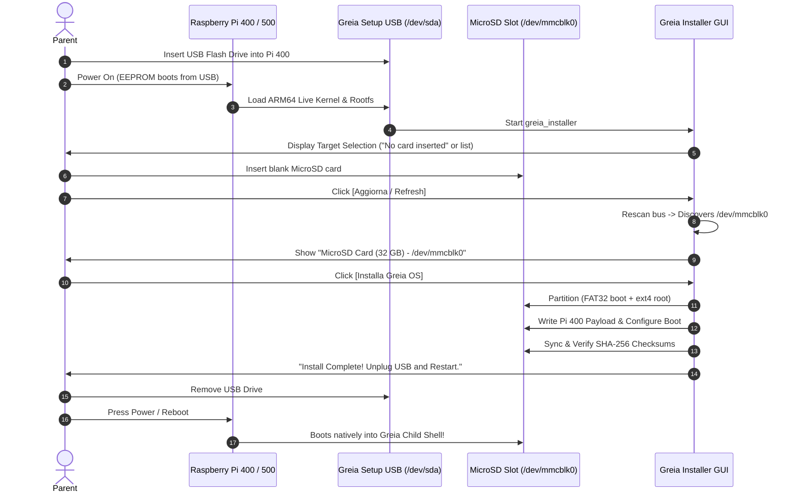

# Universal Greia Setup Media Architecture

**Status:** ARCHITECTURAL PLAN & SPECIFICATION  
**Target Milestone:** R8 / Multi-Platform Installer Convergence  
**Authority:** Aligned with [ADR 0012](file:///Users/taio84/Works/Bimbe_GIOCHI/Greia%20OS/Greia/docs/adr/0012-platform-architecture-constitution.md) (Platform Constitution), [ADR 0013](file:///Users/taio84/Works/Bimbe_GIOCHI/Greia%20OS/Greia/docs/adr/0013-declarative-image-profiles-and-composable-build-artifacts.md) (Image Profiles), and [ADR 0014](file:///Users/taio84/Works/Bimbe_GIOCHI/Greia%20OS/Greia/docs/adr/0014-greia-identity-arm-parity-and-direct-graphics-direction.md) (ARM Parity)  
**Parent Contract:** Non-Negotiable Contract #14 (*"Installation is graphical and fail-closed. Whole-disk installation may offer only verified eligible targets; payload and device identity must be rechecked before destructive work."*)

---

## 1. Executive Summary & Vision

The **Universal Greia Setup USB** (`greia-setup-universal.img`) is a single, self-contained installation medium designed to boot, detect hardware, and install Greia OS across **all supported hardware tiers**:
1. **Legacy 32-bit x86 Netbooks** (e.g. Acer Aspire One, Intel Atom N270/GMA950, BIOS).
2. **Modern 64-bit x86 Systems** (Intel/AMD family PCs, laptops, convertibles, UEFI/BIOS).
3. **Raspberry Pi 400** (All-in-one ARM64 keyboard computer, Broadcom BCM2711).
4. **Raspberry Pi 500** (Next-generation ARM64 keyboard computer, Broadcom BCM2712).

### The Core Appliance Principle
Parents should never be forced to navigate confusing architecture menus or figure out which `.img` file to download for which machine. 

```text
┌─────────────────────────────────────────────────────────────────────────┐
│                           THE GREIA SETUP FLOW                          │
│                                                                         │
│   1. Flash one universal image to a USB flash drive (≥ 4 GB).           │
│   2. Plug the USB into the target computer (PC or Raspberry Pi).        │
│   3. Turn on the computer ──▶ Graphical Greia Installer loads.          │
│   4. Installer auto-detects hardware and displays eligible targets:      │
│        • On PC: Internal HDD / SSD                                      │
│        • On Pi: Inserted MicroSD Card (/dev/mmcblk0) or NVMe            │
│   5. Click [Installa Greia] ──▶ System is installed with verification.  │
│   6. Unplug USB and reboot ──▶ Machine boots directly into Greia Shell. │
└─────────────────────────────────────────────────────────────────────────┘
```

---

## 2. Hybrid Media Partition & Boot Architecture

Booting legacy BIOS x86, modern UEFI x86-64, and Raspberry Pi ARM64 from the **exact same USB flash drive** requires a hybrid partition layout where boot structures intentionally overlap without collision.

```text
+-------------------------------------------------------------------------------------------------------+
|                                    UNIVERSAL GREIA SETUP USB LAYOUT                                   |
+-------------------------------------------------------------------------------------------------------+
| Sector 0 (MBR): GRUB stage-1 boot code + DOS partition table (with type 0xEF & active flags)          |
| Sectors 1–2047: GRUB post-MBR embedding space (grub core.img with biosdisk, ext2, fat, part_msdos)    |
+-------------------------------------------------------------------------------------------------------+
| Partition 1 (FAT32, ~512 MiB): SYSTEM-BOOT (ESP / Raspberry Pi Firmware)                             |
|  ├── [Raspberry Pi Firmware & Boot Files]                                                             |
|  │     ├── bootcode.bin, start4.elf, fixup4.dat, start_4d.elf                                         |
|  │     ├── config.txt, cmdline.txt                                                                    |
|  │     ├── overlays/ (vc4-kms-v3d.dtbo, disable-bt.dtbo, etc.)                                        |
|  │     ├── bcm2711-rpi-400.dtb, bcm2712-rpi-500.dtb                                                   |
|  │     └── kernel8.img (ARM64 Live Kernel) + initrd-arm64.img                                         |
|  └── [PC UEFI ESP Structure]                                                                          |
|        └── EFI/                                                                                       |
|             └── BOOT/                                                                                 |
|                  ├── BOOTX64.EFI (64-bit UEFI GRUB binary)                                            |
|                  ├── BOOTIA32.EFI (32-bit UEFI GRUB binary for early Intel Atom tablets)               |
|                  └── grub.cfg (Multi-arch GRUB configuration)                                         |
+-------------------------------------------------------------------------------------------------------+
| Partition 2 (ext4, ~2.5–3.5 GiB): GREIA_SETUP (Live Environments + Shared Payloads)                   |
|  ├── boot/                                                                                            |
|  │     ├── vmlinuz-i386, initrd-i386 (32-bit PC live kernel)                                          |
|  │     └── vmlinuz-amd64, initrd-amd64 (64-bit PC live kernel)                                        |
|  ├── live/                                                                                            |
|  │     ├── rootfs-x86_32.squashfs (Minimal live system for 32-bit PC)                                 |
|  │     ├── rootfs-x86_64.squashfs (Minimal live system for 64-bit PC)                                 |
|  │     └── rootfs-arm64.squashfs (Minimal live system for Raspberry Pi)                               |
|  └── payloads/ (Target System Install Payloads)                                                       |
|        ├── shared/ (Architecture-Neutral Asset Layer: 41 Activities, Voices, Audio, Icons, Themes)    |
|        ├── targets/                                                                                   |
|        │     ├── acer-aspire-one-i386.tar.zst                                                         |
|        │     ├── modern-amd64.tar.zst                                                                 |
|        │     ├── rpi400-arm64.tar.zst                                                                 |
|        │     └── rpi500-arm64.tar.zst                                                                 |
|        └── manifests/ (Cryptographic SHA-256 digests & target profiles)                               |
+-------------------------------------------------------------------------------------------------------+
```

### How Each Platform Boots from This Layout

1. **Legacy PC BIOS (e.g. Acer Aspire One)**:
   - System reads MBR Sector 0 $\to$ GRUB stage-1 executes $\to$ loads `core.img` from sectors 1–2047.
   - GRUB reads Partition 2, boots `vmlinuz-i386` + `initrd-i386`, and overlays `rootfs-x86_32.squashfs`.
   - Boots directly into `greia_installer` via Linux direct KMS/Xorg session.

2. **Modern 64-bit UEFI PC**:
   - UEFI firmware queries Partition 1 (marked with partition type `0xEF` or ESP GUID).
   - Executes `EFI/BOOT/BOOTX64.EFI` $\to$ GRUB reads `grub.cfg`.
   - Boots `vmlinuz-amd64` + `initrd-amd64` and overlays `rootfs-x86_64.squashfs`.
   - Boots directly into `greia_installer`.

3. **Raspberry Pi 400 & Pi 500**:
   - The Raspberry Pi on-board EEPROM bootloader searches USB storage by default.
   - It ignores the MBR and UEFI binaries completely.
   - It mounts Partition 1 (FAT32), reads `config.txt` and `start4.elf`, applies the Device Tree overlay (`bcm2711-rpi-400.dtb`), and launches `kernel8.img` with `cmdline.txt`.
   - The ARM64 initramfs mounts Partition 2 by label (`LABEL=GREIA_SETUP`), overlays `rootfs-arm64.squashfs`, and launches `greia_installer`.

---

## 3. The Raspberry Pi USB-to-Card Flashing Workflow

On traditional PCs, the USB stick writes to an internal SATA/NVMe drive. On the Raspberry Pi 400/500, **the USB stick acts as a hardware appliance installer that writes to the inserted MicroSD card or NVMe expansion**.



---

## 4. Installer Application Architecture (`greia_installer`)

The installer is written in **Python + Pygame** using platform services from `greia_platform`. Because Python and Pygame run on both x86 and ARM64, the **installer application is a single, unified codebase**.

### Key Architectural Enhancements

#### 4.1. Universal Target Drive Discovery & Self-Exclusion (`disk.py`)
The installer must strictly exclude the boot drive running the installer:
- **Identification**: Checks `mountpoint == "/run/live/medium"` or samples the disk UUID matching `LABEL=GREIA_SETUP`.
- **Exclusion**: The physical device hosting this partition (e.g. `/dev/sda`) is filtered out of the target list so a parent **can never accidentally overwrite the installer USB**.
- **Block Device Support**:
  - ATA/SATA/IDE (`/dev/sd*`)
  - NVMe (`/dev/nvme*n*`)
  - MMC/MicroSD (`/dev/mmcblk*`)
  - Virtual drives for testing (`/dev/vd*`, `/dev/loop*`)

#### 4.2. Dynamic Drive Refresh Button
Parents may boot the USB before inserting the MicroSD card on a Pi, or connect an external USB-SATA adapter after boot.
- The UI exposes a prominent, child-safe **[Aggiorna Dischi / Refresh Drives]** button.
- Triggers `DiskManager.scan_devices(force_rescan=True)`, querying `lsblk -J -b -o NAME,SIZE,MODEL,TRAN,TYPE` and `/sys/block`.
- Smoothly updates the UI card selection without restarting the application.

#### 4.3. Hardware Probing & Automatic Profile Selection (`hardware_enablement.py`)
The installer probes the host architecture and hardware components automatically:

```python
def detect_target_profile() -> str:
    machine = platform.machine().lower()
    
    if machine in ("aarch64", "arm64"):
        # Raspberry Pi Device Tree inspection
        dt_model_path = Path("/proc/device-tree/model")
        if dt_model_path.exists():
            model = dt_model_path.read_text().strip("\x00").lower()
            if "raspberry pi 5" in model:
                return "rpi500-arm64"
            if "raspberry pi 4" in model:
                return "rpi400-arm64"
        return "rpi400-arm64" # Default ARM64 reference
        
    elif machine in ("x86_64", "amd64"):
        # Check if running on 64-bit capable machine
        return "modern-amd64"
        
    elif machine in ("i386", "i686"):
        # 32-bit x86 Netbook (e.g. Acer Aspire One)
        cpuinfo = Path("/proc/cpuinfo").read_text()
        has_pae = "pae" in cpuinfo.split()
        return "acer-aspire-one-i386" if has_pae else "acer-aspire-one-i386-nonpae"
```

The user is shown a clear summary card:
> **Rilevato:** Raspberry Pi 400 (ARM64)  
> **Profilo consigliato:** Greia OS per Raspberry Pi 400  
> *(Un pulsante opzionale "Avanzate" consente di selezionare un profilo diverso se necessario).*

---

## 5. Smart Payload Deduplication & Disk Budget

Carrying 4 separate operating systems could inflate the image beyond 5 GB. However, Greia's architectural separation between **platform binaries** and **child assets** allows massive deduplication:

```text
┌─────────────────────────────────────────────────────────────────────────┐
│                      PAYLOAD SIZE DECOMPOSITION                         │
│                                                                         │
│  Architecture-Neutral Assets (SHARED ONCE across all targets):          │
│    • 41 Built-in Activities (Python code, visuals, game logic) : 280 MB │
│    • Character Audio & System Speech (180 reactions, 12 intros): 140 MB │
│    • SVG Graphics, Wallpapers, UI Fonts, Animal Icons          :  45 MB │
│    SUBTOTAL SHARED ASSETS                                      : 465 MB │
│                                                                         │
│  Architecture-Specific OS Roots (Compressed zstd deltas):               │
│    • acer-aspire-one-i386 (Debian 32-bit base, kernel, drivers): 320 MB │
│    • modern-amd64         (Debian 64-bit base, kernel, drivers): 360 MB │
│    • rpi400-arm64         (Debian ARM64 base, Pi firmware)     : 380 MB │
│    SUBTOTAL OS ROOTS                                           : 1.06 GB│
│                                                                         │
│  Live Boot Environments (3 mini-squashfs roots):               : 600 MB │
│                                                                         │
│  TOTAL UNIVERSAL USB IMAGE SIZE                                ≈ 2.1 GB │
└─────────────────────────────────────────────────────────────────────────┘
```

A **2.1 GB image** fits easily onto any standard **4 GB or 8 GB USB flash drive**, making downloads fast and storage requirements minimal.

---

## 6. Target Partitioning & Installation Logic by Target Class

When the installer commits changes to the chosen destination disk, it applies the appropriate disk layout based on the target profile:

### Case A: Installing to PC (Internal HDD / SSD)
1. Creates an MBR partition table (or GPT for modern UEFI).
2. Formats a single root partition `ext4` with label `GREIAROOT`.
3. Unpacks the shared asset layer and architecture root (`tar --zstd -xf`).
4. Installs GRUB bootloader to the disk MBR / ESP:
   ```bash
   grub-install --target=i386-pc /dev/sda
   # or for UEFI:
   grub-install --target=x86_64-efi --efi-directory=/boot/efi --bootloader-id=Greia
   ```
5. Writes `/etc/fstab` with exact partition UUIDs.

### Case B: Installing to Raspberry Pi (MicroSD Card `/dev/mmcblk0`)
1. Creates an MBR partition table with two partitions:
   - **Partition 1 (`/dev/mmcblk0p1`)**: FAT32 (~256 MiB), type `0x0c` (FAT32 LBA), label `bootfs`.
   - **Partition 2 (`/dev/mmcblk0p2`)**: ext4 (remaining disk), type `0x83` (Linux), label `rootfs`.
2. Mounts `/dev/mmcblk0p1` $\to$ `/mnt/target/boot/firmware`.
3. Mounts `/dev/mmcblk0p2` $\to$ `/mnt/target`.
4. Copies Pi boot firmware (`start4.elf`, `config.txt`, `cmdline.txt`, kernel, dtbs) to `/mnt/target/boot/firmware`.
5. Unpacks the shared asset layer and `rpi400-arm64` rootfs to `/mnt/target`.
6. Configures `cmdline.txt` with root filesystem UUID:
   ```text
   console=serial0,115200 console=tty3 root=PARTUUID=<uuid>-02 rootfstype=ext4 fsck.repair=yes quiet loglevel=0 vt.global_cursor_default=0 rootwait
   ```
7. Writes `/etc/fstab`:
   ```text
   PARTUUID=<uuid>-01  /boot/firmware  vfat    defaults          0  2
   PARTUUID=<uuid>-02  /               ext4    defaults,noatime  0  1
   ```

---

## 7. Implementation Roadmap & Milestones

The Universal Installer architecture converges with the active implementation plan as follows:

```text
Phase R8 (ARM64 Core & Image Adapters)
  ├── 1. Author rpi400-arm64 and rpi500-arm64 declarative image profiles.
  ├── 2. Implement build/build-rpi-image.sh producing valid Pi bootable images.
  └── 3. Verify Raspberry Pi 400 display, audio, keyboard, and performance.
         │
         ▼
Phase R8.B (Universal Setup Media Convergence)
  ├── 1. Update src/greia_installer/disk.py:
  │        • Add dynamic rescan (refresh button).
  │        • Add boot media self-exclusion logic.
  │        • Support /dev/mmcblk* and /dev/nvme* targets seamlessly.
  ├── 2. Update src/greia_installer/hardware_enablement.py:
  │        • Add /proc/device-tree/model ARM hardware auto-detection.
  ├── 3. Build script: build/build-universal-setup-image.sh:
  │        • Formats the hybrid MBR/FAT32/ext4 image.
  │        • Compiles live-x86 and live-arm64 boot assets.
  │        • Packages the deduplicated shared payload pool.
  └── 4. Physical verification:
           • Boot single USB on Acer Aspire One -> Install to internal disk.
           • Boot single USB on modern UEFI PC -> Install to internal NVMe.
           • Boot single USB on Raspberry Pi 400 -> Install to MicroSD card.
```

---

## 8. Summary of Product Advantages

| Dimension | Multi-Image Approach (Old) | Universal Setup USB (New Architecture) |
| :--- | :--- | :--- |
| **Parent Friction** | Must know CPU bitness, BIOS vs UEFI, and board model before downloading. | **Zero friction**: Download one file, flash to one USB. |
| **Classroom / Lab Deployment** | Teachers must carry separate USB keys for PCs and Raspberry Pis. | **One USB key** sets up every laptop, netbook, and Pi in the school. |
| **Installer Safety** | Potential risk of selecting the wrong image for underpowered hardware. | **Auto-detects** hardware constraints and chooses the optimal C0–C2 profile. |
| **Maintenance & Code Reuse**| Multiple installer branches and separate build pipelines. | **One Python installer codebase**, shared asset deduplication, unified test matrix. |
