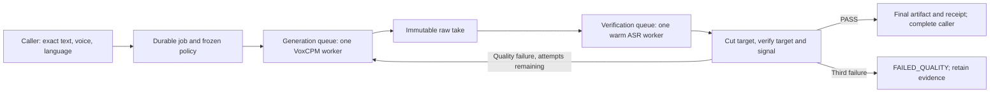

# Shared verified voice production pipeline

**Date:** 2026-10-22  
**Status:** PROPOSED implementation design; not implemented or activated.  
**Owner intent:** automatic localized carriers for short speech; up to three total
fresh takes until Whisper passes; separate generation/verification queues;
default verification with explicit bypass; reusable tool and Greia integration.

## Authority

This README is the sole executable implementation authority **for this proposed
voice-engine extension once adopted**. It extends the existing localization/voice
workstream; it does not replace its corpus scope, selected voices, human acceptance,
architecture remediation or release authorities. No session has been executed.
Existing paused v4 corpus plans and historical v5 trials stay immutable. No bulk
restart is authorized by this document. The owner is currently discussing design.

The reusable implementation belongs in existing shared VoxStage, not a new tool.
Greia owns semantic speakers, canonical masters, native pedagogical exclusions,
asset encoding and installation transactions. Shared core knows no Greia actor IDs
or runtime paths. No second model server, provider queue or project-owned verifier
is introduced for the default VoxStage route.

## How to use this plan

Execute one numbered session at a time after design adoption, with its scoped
commit and evidence. Review the handoff before proceeding. Source work 00–06 uses
fake renderer/transcriber boundaries only. Session 07 is the only live gate. A
failure does not authorize another investigation, a model download or bulk work.

## Execution order

| Order | File | Outcome |
|---:|---|---|
| 00 | [00-policy-contract.md](00-policy-contract.md) | Typed frozen policy and real failure fixtures |
| 01 | [01-target-extraction.md](01-target-extraction.md) | Shared target extraction, no intro text gate |
| 02 | [02-verification-worker.md](02-verification-worker.md) | One warm offline ASR worker and explicit verdicts |
| 03 | [03-durable-ledger.md](03-durable-ledger.md) | Persisted attempts, leases and replay-safe transitions |
| 04 | [04-dual-queue-scheduler.md](04-dual-queue-scheduler.md) | Bounded render/verify stages and three-take retry loop |
| 05 | [05-public-api.md](05-public-api.md) | Default verified API/CLI, script results and legacy handling |
| 06 | [06-greia-adoption.md](06-greia-adoption.md) | One Greia route, pipelined batches, no nested retry/wrapper |
| 07 | [07-live-acceptance.md](07-live-acceptance.md) | Measured local resource/latency and multilingual evidence |

## Adopted default update — 2026-10-22

The owner selected Base and default accent-insensitive comparison after the matched
Tiny/Base experiment. This default-policy change is implemented in the current
Greia engine/cutter; the shared queued pipeline below remains proposed. Carry
ignore_accents=true through policy schemas and freeze it per job; explicit false
restores strict comparison. Fold only ASR comparison text, never source scripts.
The original evidence baseline remains a dated snapshot, not current defaults.

## Design contract

### Public caller experience

A blocking convenience call and asynchronous handle use the same durable job:

```python
handle = client.submit_recording(
    text="Trouve Luna.", voice_id="saved-immutable-voice-id", language="fr",
    verification="required", max_attempts=3,
    short_text={"mode": "auto", "max_words": 4, "max_alnum": None},
    delivery="Clear, natural conversational delivery.",
    idempotency_key="project-cue-version",
)
result = handle.result(timeout=1800)  # async callers await handle.wait()
```

`max_words=4` means fewer than five Unicode orthographic words. Optional
`max_alnum` adds an AND character-count limit; null means no character selection
limit. `mode=off` disables wrapping. The exact semantic target is never rewritten.
One logical recording is one original planner chunk/alternative, not a whole
multi-speaker script. Chunk first, then freeze the carrier decision for each chunk.
Wrap intro + target in **one synthesis recording**; never synthesize them
separately or split the composite. If the composite exceeds the configured backend
chunk limit, reject with `CARRIER_TOO_LONG` before submission, rather than silently
splitting it. Plan preview shows the actual spoken composite and original target.

Language is explicit, never inferred from a direction string. Native carrier map
starts with en/it/fr/es and the existing sentences from the saved trials. Frozen
short-phrase strategy is ellipsis + blank line and the explicit two-second pause
instruction used in the trials. This is a practical starting strategy, not a
claimed two-second guarantee or a proven optimum; the PCM boundary decides.
Delivery language, caller acting prompt, carrier instruction and composite length
are validated before allocating an attempt. Never truncate direction silently.

Verification defaults to `required`. `off` bypasses quality scoring and returns
`UNVERIFIED`, never PASS. **Automatic carrier extraction still requires word
alignment**: disabling quality scoring alone cannot promise zero Whisper work.
For no ASR at all, set both `verification=off` and `short_text.mode=off`. Carrier
boundary safety remains enforced even with quality scoring disabled.

### Result and three-take contract

- Each unit has one persisted generation budget: attempts 1, 2, 3; stop on first
  machine PASS. Configurable bound is 1–3, default 3. New seed per attempt, same
  voice/reference, exact text, locale and delivery policy. Derive each 32-bit
  attempt seed from the first four SHA-256 bytes of the UTF-8 string
  `base_seed:unit_id:alternative:attempt`, interpreted unsigned big-endian;
  do not use Python process-randomized hash(). Replaying one attempt
  reuses its seed/key; it does not consume a new take.
- Retry only audio/quality outcomes: `NO_TARGET_ALIGNMENT`, `NO_USABLE_PAUSE`,
  `TARGET_MISMATCH`, `INVALID_GENERATED_AUDIO`. Do not regenerate because ASR is
  unavailable, the disk is full, HTTP timed out, or a model worker crashed.
- After three quality failures, terminal `FAILED_QUALITY`; retain all takes and
  transcripts. No approved output path, no silent last/best-take success. A
  diagnostic candidate may be exposed separately as `candidate_path`.
- Missing verifier/cached weights is `BLOCKED_VERIFIER`, before generation.
  Transcription crash/timeout is `BLOCKED_VERIFIER` with the existing audio kept.
  Retry the verification stage on resume, not synthesis. Infrastructure faults
  do not manufacture three new voices or count as failed quality takes.
- Request wait timeout or client disconnect does not cancel or resubmit work.
  Reattach using the same durable job/idempotency key. Cancellation persists
  before any retry; late worker completion cannot publish a cancelled result.
- Terminal success is `VERIFIED` plus `human_review=PENDING`. The returned final
  PCM is the cut target for short cues, original speech for ordinary cues. Quality
  PASS is strict similarity **>0.8**, with signal/boundary checks satisfied.
  `0.8` fails. Short extracted targets also require normalized token-count equality
  to prevent an added/repeated word passing a forgiving similarity score. Expected
  legitimate repetitions are preserved. Ordinary long speech retains the score
  policy. It is transcript screening, not a pronunciation/identity guarantee.
- All normal character voices, including Dani and one-word phrases, are checked.
  Do not copy Greia's current ASR exclusions into shared ordinary recording.
  Deterministic pedagogical letters/syllables remain on Greia's separate native
  route, with explicit exemption metadata; no inference from short text alone.

### Worker and resource ownership



Reuse VoxStage's server lease, saved voices, renderer and job storage. Add
`ProductionCoordinator` as the **single ledger writer**, a generation worker and
a dedicated ASR subprocess. Workers receive immutable stage inputs and return
completion messages; they never mutate shared job dictionaries. The coordinator
persists transitions under the existing service guard with atomic/fsynced writes.
Do not let two threads independently write `job.json` from stale snapshots.

Scheduling unit is a recording/attempt, not the entire script. A fresh raw take
is queued for verification while generation advances to another ready unit.
Retries re-enter the tail; no worker waits synchronously for another worker while
holding its queue or service lock. Final script mixes are built only when every
required unit has its selected successful alternative. Failed chunks alone retry.

Bounds: keep existing 32 active-job admission limit, 8 total rendered candidates
awaiting/under verification, and one generation + one ASR worker. Admission
reserves one candidate slot before synthesis; release only after verification
transition commits. Use per-job round-robin readiness and put retries after that
job's other ready units. Disk exhaustion blocks admission. Persisted candidates
are paths/hashes, not arrays held in a queue. Final artifacts retained until
explicit user purge; temporary ASR files removed after each stage.

**Two queues do not imply two unlimited GPU workloads.** This Mac has 16 GiB RAM
(`sysctl hw.memsize`, read 2026-10-22). Both current engines use MLX/Metal.
`accelerator_mode=serialized` is the safe initial policy: acquire an inference
lease for each GPU stage; release it before postprocessing/waiting. Give ready
verification stages priority once the 8-candidate bound is reached; otherwise
alternate ready GPU stages. CPU file/PCM work can overlap. Opt-in `overlap` must
pass session 07; keep one worker of each type and the same queue bounds.
Do not claim throughput improvement merely because threads overlap. A CPU ASR
backend is a future explicit adapter, not an assumed capability or new download.

### ASR work and cutting

Move the generic target-suffix extraction implementation into shared VoxStage;
leave the Greia CLI as a compatibility adapter. Shared code never imports Greia.
Align the final target, ignore discarded intro content, locate a measured PCM
pause, then cut. Use the current v6 suffix/PCM safety policy and shared diacritic normalization.

One full-clip word-timestamp transcription plus one extracted-target transcription
is the maximum normal short-take path. Reuse the latter for both boundary safety
and quality scoring; do not run a third verifier transcription. Ordinary speech
gets one transcription. No discarded-intro transcription. No expected transcript
or initial prompt supplied to ASR; locale direction is explicit. Save raw ASR
results before parsing so retries/debugging can distinguish model errors from
parser errors. Cache only by audio hash + model revision + locale + all decoding
settings. Never reuse source ASR for a different cut/hash.

Warm subprocess uses an explicitly configured installed interpreter and cached
Whisper model. Probe model weights and imports before accepting verified jobs;
no installation/download. Owner-selected configured model is installed multilingual Whisper Base
(`mlx-community/whisper-base-mlx`, pinned revision
`1e3e249fb8d01c655324bd6841b1deadffd6d04c`),
with deterministic decoding settings frozen per job. Model is configurable only
to an already cached revision. A stronger model is not silently downloaded.

False rejects remain possible: the French trials prove that three takes can all
fail an imperfect recognizer. Keep the capped retry requested by the owner, but
report unresolved outcomes truthfully. Do not lower thresholds after observing a
failure, change the target, manually approve a take, or repeatedly rerun ASR until
it happens to pass. A different verifier policy means a new explicit evaluation.

Final target signal checking is separate from the disposable raw carrier: do not
reject a deliberate two-second intro pause under the final-output silence limit.
Use the existing agreed final-target silence policy (internal/tail pauses below
1.5 seconds do not warn; 1.5 seconds and above fail default quality), configurable
for explicitly intentional pauses. Clipping/invalid/near-silent results fail.
Pitch, emotion and identity are not inferred from Whisper.

### Persistence and publication

Extend each existing shared `job.json` with schema version, immutable resolved
production policy and per-unit ledger. Key: `(job_id, recording_id, alternative,
attempt_number)`. Persist seed, backend/voice reference, composite/target text,
raw/cut paths and hashes, ASR model/settings/results, scores and stage timings.
Stages: `READY_GENERATION -> GENERATING -> READY_VERIFICATION -> VERIFYING ->
VERIFIED | QUALITY_REJECTED`; quality rejection allocates next attempt once or
ends `FAILED_QUALITY`. Distinct states: `UNVERIFIED`, `BLOCKED_VERIFIER`,
`BLOCKED_PROVIDER`, `CANCELLED`, `UNKNOWN_SUBMISSION`, `PUBLISHING`.

Lease token plus server incarnation fences stale completion. On restart, reconcile
an existing raw/hash before considering synthesis; in-flight verifier stages
resume on the same audio. Persist raw file/hash before making it verifiable.
A candidate recorded as generated must never be regenerated just because the
process crashed before verification. Shared renderer is in-process: persist the
attempt seed before inference; an orphan raw file is reconciled or marked unknown,
never counted as a new logical attempt. No pretend exactly-once guarantee around
an uncheckpointed hardware call. Externally uncertain submissions stay under their
same idempotency key until reconciled.

A successful artifact is durably written and hashed before the atomic job update
publishes it. API result never points to a failed/raw short take. Keep immutable
attempts after selecting a winner. Greia downloads the selected final artifact,
validates/encodes using AudioPipeline, and writes a receipt carrying shared quality
and carrier provenance. Corpus installation remains its existing recoverable
transaction; no direct shared-tool writes into runtime assets.

### Integration and compatibility

- New `RecordingRequest` and `/v2/recordings` submit/get/wait endpoints provide the
  reusable single-utterance contract. New Python `RecordingClient` and CLI
  `voxstage record` use them; submit returns promptly, wait attaches to the same ID.
- New `/v2/jobs` script requests gain explicit `language` at script/segment level and
  a frozen `production` policy; new v2 ordinary renders default to verified. No
  locale guessing from direction. Missing language is a local validation error
  when wrapping/verification is enabled. Explicit legacy unverified operation
  requires both policies off; capabilities describe this before Greia adoption.
- `speak` delegates to the new recording route. New script renders are coordinated
  per original planner recording. `takes` remains requested alternatives; each
  alternative has its own three-attempt bound, never nine attempts from nested
  policy loops. Voice-design jobs stay on their explicit audition workflow.
- Old persisted jobs without production policy resume **legacy-unverified**, retain
  their frozen text/references, and are never retroactively marked verified. The unchanged `/v1/jobs` API remains a legacy-unverified compatibility surface;
  updated `render` uses `/v2/jobs`. Old HTTP clients must not receive any claim
  of verification. Never silently fall back from v2 to v1. Update
  terminal-state polling and error schemas together with route activation.
- Greia VoxStageProvider uses the shared result; VoiceEngine does not wrap, verify
  again or retry that provider. CLI `generate`, `request`, `batch`, corpus producers
  and Python `generate/submit/generate_many` resolve the same policy.
- Greia batch/corpus submits a rolling window of 8 requests before waiting;
  a for-loop that calls blocking generate before submitting the next request is
  deliberately not the pipelined batch implementation. Default VoxStage clients
  no longer hold Greia's global generation.lock across shared waits: the shared
  server lease owns model serialization. Keep legacy Chatterbox model locking,
  a per-run corpus writer lease and per-output publication exclusion. Reject two
  requests for the same output before provider work; do not race audio/receipts.
  Do not downgrade or remove corpus transactional/hash protection.
  Batch completions may be out of order but cue IDs/output paths remain stable.
  Corpus store/installation remains single-writer. Existing hash/backup rules stay. When adopting a prior corpus cue, import its
  cumulative generated-attempt count and saved raw candidates before allocating
  work. A new queue/job ID cannot reset an exhausted three-take cue budget.
  A zero-remaining cue returns unresolved without a provider call; a separate
  owner-authorized new recording operation can deliberately establish a new budget.
- Chatterbox remains selectable. It retains its separate existing legacy path;
  it must advertise no verified asynchronous v2 capability. Requests for the new
  quality pipeline on an unsupported provider reject before synthesis; explicit
  legacy bypass is available. No silent quality downgrade or fallback provider.

## Evidence baseline

- Greia source at `b59d92d42`: `engine.py` holds generation lock through verify;
  warns/retries and packages the last failed take. Request defaults to 2 attempts.
- `verification.py` excludes Dani and tiny/semantic classes; `auto` can skip a
  missing verifier. Corpus runner adds its own carrier/attempt loop.
- `service.py` accepts one socket request at a time; `cmd_batch` calls blocking
  generate serially. Releasing a lock alone cannot pipeline either caller.
- VoxStage currently owns one ThreadPoolExecutor renderer, a 32-job admission
  limit and atomic job JSON, but executes whole jobs before the next. New state
  cannot safely be written from independent worker snapshots.
- Two saved French trials with clear pauses failed because Whisper heard other
  words; manual cuts are listening evidence only, not automatic pipeline proof.
- VoxStage working tree is already dirty in service/API/schema/docs/tests.
  Snapshot/diff it and preserve those changes; do not stash, reset, stage or commit
  them wholesale. Record actual file hashes before execution.

## Global rules

Production code is untouched by this planning turn. No live model calls, model
installs, hosted Actions or corpus replacements during sessions 00–06. Commit
coherent scoped source to each repository's existing main; no branches. Every
session refreshes its main head and preserves concurrent/dirty work. No generic
new queue database: reuse the existing single-owner durable job records.

The configured model/interpreter readiness and live resource policy are explicit
setup facts, not guessed defaults. Start/stop/unload of the existing shared server
must preserve other projects' work. Source readiness never proves listening quality.

## Handoff contract

Return session ID; source SHAs and dirty-hunk provenance; scoped diff; exact tests
and exit codes; generated artifact paths/hashes; live/provider-call count observed
at the acquisition boundary; stop-condition audit; remaining unproved predicates.
Cumulative gate command is session-specific below; a skipped command is no proof.
Full Greia verification previously aborted with signal 6; do not describe it as
green or rerun endlessly. Focused suite and named full-gate residuals are distinct.

## Global stop conditions

Stop if a policy/voice/locale/expected text changes during resume; a worker loses
its lease; quality-off becomes PASS; nested retry/wrapping remains; an unrelated
dirty hunk would be overwritten; model files must be downloaded; verifier is
missing; an unknown submission would be rerolled; any required local/cumulative
gate fails. Session 07 may report a failed live predicate without authorizing
unbounded retakes or bulk production.

## Design review record

Source baseline (archived; see git history) records current hashes and shared
dirty paths. Adversarial review (archived; see git history) records the two
planning review passes and unresolved live predicates. Document validation checks
plan structure only; it does not prove the future pipeline works.


## Owner-authorized immediate Greia routing — 2026-10-22

The owner explicitly required automatic short routing in normal recording calls.
Implemented now in the existing Greia VoiceEngine using `short_policy.py`,
`short_phrases.py`, `short_delivery.py` and shared `target_quality.py`: default
≤4 words, per-request mode/word/optional-alnum overrides, native pedagogical
exclusion, retained carrier evidence, three-take cap and final delivered Base
checks. CLI, JSONL, Python and warm-service calls share that route. Corpus raw
requests bypass wrapping internally, preserving existing frozen scope/budgets.

This is the immediate Greia entry-point integration; it does not execute or close
sessions 00–07 of the proposed shared VoxStage durable/dual-queue programme.
Current calls remain serial. A later shared implementation must replace the
local lifecycle behind the adapter, reusing policy/evidence and avoiding nested
retries or two owners. The original proposed shared API is not yet callable.
